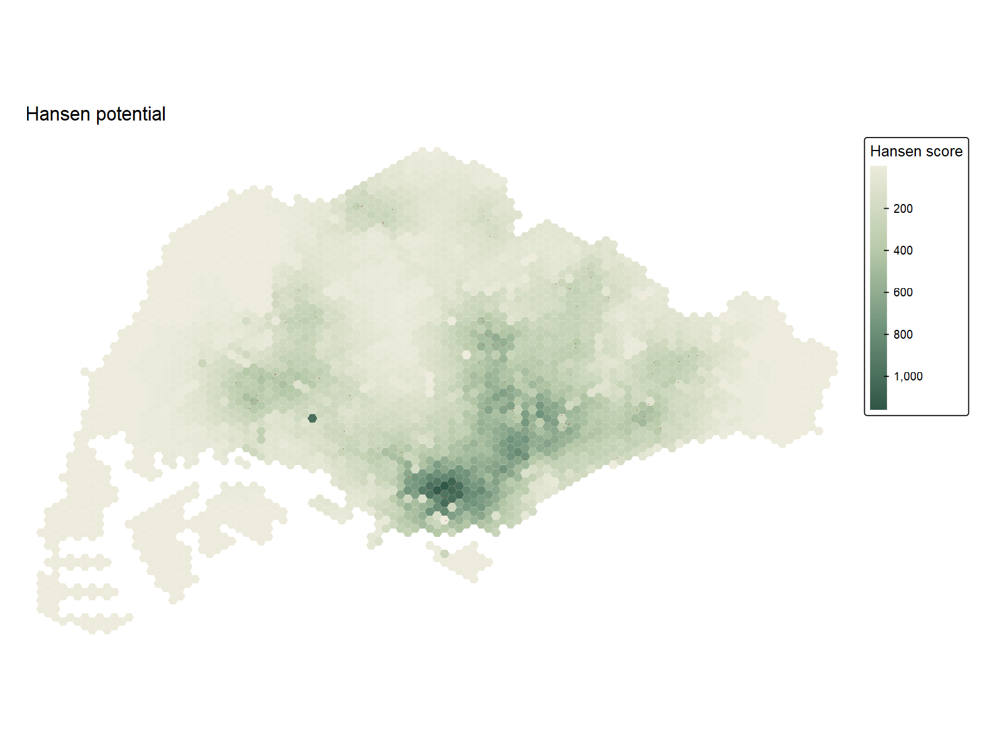
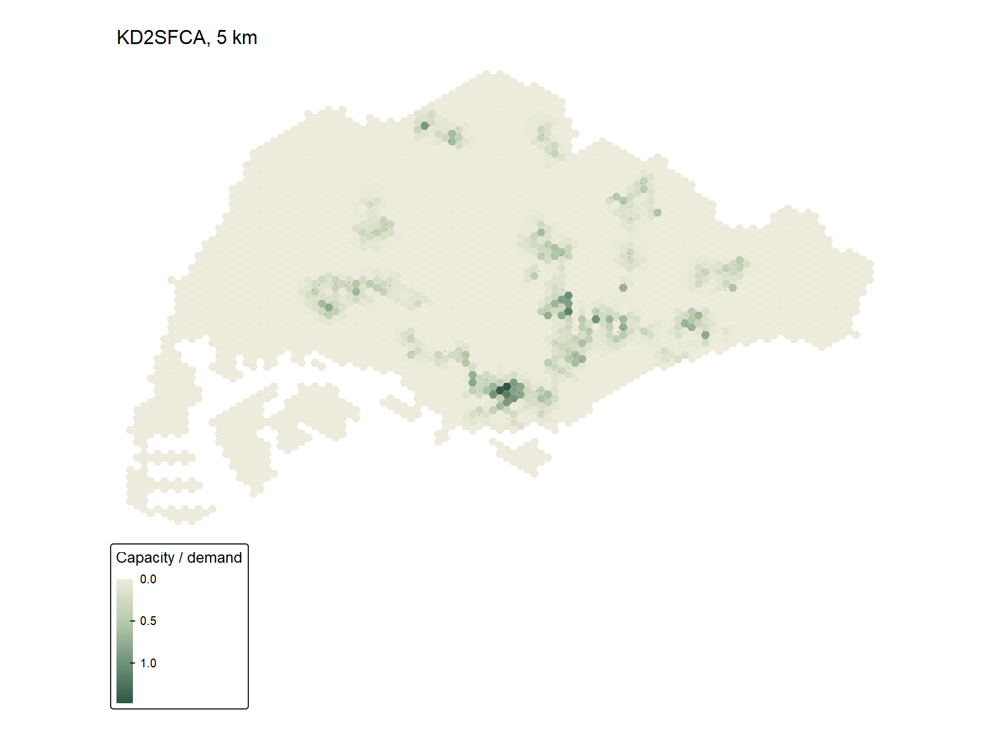
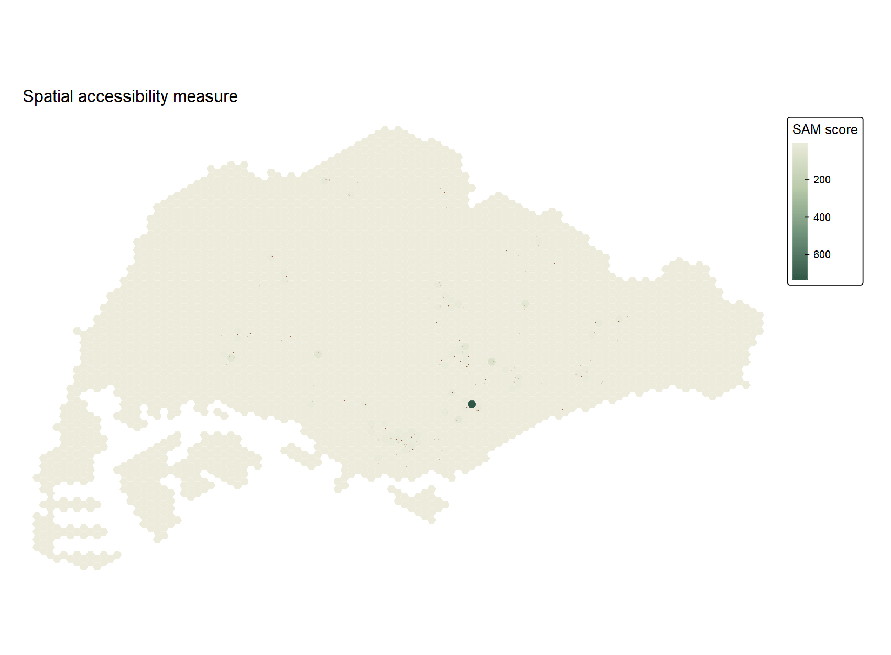
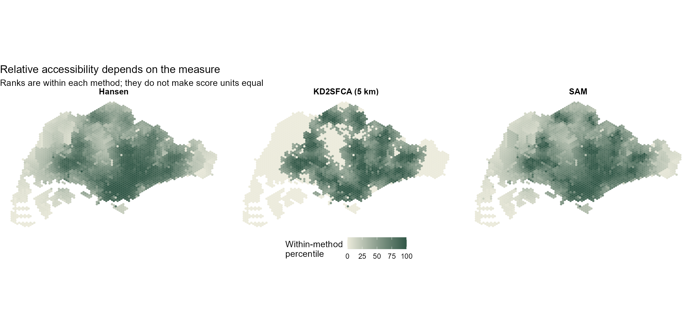
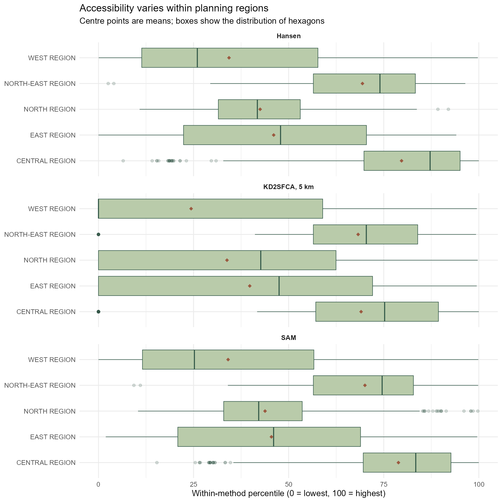
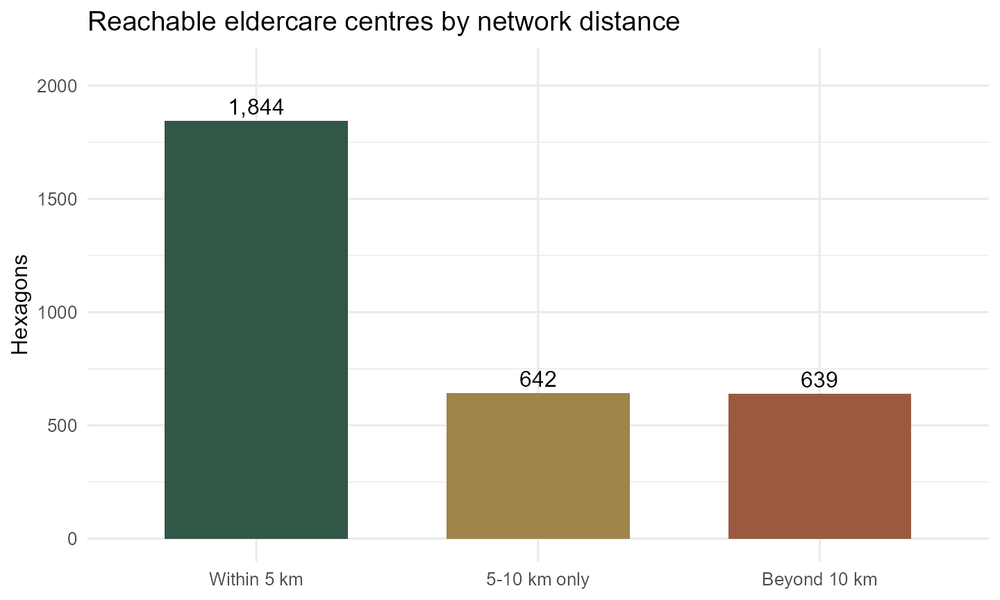

```{r}
#| include: false
source("Hands-on_Ex/Hands-on_Ex07/analysis.R", encoding = "UTF-8")
```

## The question

Where do Singapore's eldercare centres appear easier to reach from the supplied hexagon origins, and how much does that answer change with the accessibility measure? I follow the data-preparation, Hansen, KD2SFCA and spatial accessibility measure (SAM) sequence in [Chapter 17 of *R for Geospatial Data Science and Analytics*](https://r4gdsa.netlify.app/chap17.html). I then compare their **relative** rankings and test the five-kilometre catchment choice. This is an exercise in method, not an assessment of whether actual older residents have enough services.

The analysis uses the ZIP supplied for this exercise, not substituted web data. Its four inputs are Master Plan 2014 subzones, a hexagon grid, eldercare centre points and a precomputed network origin–destination (OD) matrix. The workbook describes three inputs as course-prepared teaching data. I therefore keep the raw archive and extracted data local; the site publishes my scripts, summaries and figures, but not the underlying OD records or shapefiles. The [reproduction notes](README.md) and [input manifest](outputs/input-manifest.csv) identify the exact files and checksums.

## Preparing and checking the data

The archive contains `r nrow(mpsz07)` subzones, `r nrow(hex07)` hexagon origins, `r nrow(elder07)` eldercare destinations and `r format(nrow(od07), big.mark=",")` OD pairs. That is exactly `r nrow(hex07)` × `r nrow(elder07)`: every origin has one cost to every destination. The OD file has no missing or duplicated pair, and its total cost equals entry + network + exit cost within a numerical tolerance. Nine subzone geometries were initially invalid and were repaired before the regional join.

```{r}
#| echo: false
knitr::kable(audit07, col.names = c("Validation check", "Result"))
```

The shapefiles already use the SVY21 metre grid, although their `.prj` metadata omit the EPSG authority code. I **assign** EPSG:3414 to those existing coordinates; I do not transform them as though they were longitude and latitude. The OD cost is supplied in metres. Dividing by 1,000 makes the distance matrix consistent with the kilometres used by `SpatialAcc::ac()` and the five-kilometre catchment.

```{r}
#| eval: false
#| code-fold: show
subzones <- sf::st_read("Hands-on_Ex/Hands-on_Ex07/data/geospatial/MP14_SUBZONE_NO_SEA_PL.shp")
hexagons <- sf::st_read("Hands-on_Ex/Hands-on_Ex07/data/geospatial/hexagons.shp")
centres <- sf::st_read("Hands-on_Ex/Hands-on_Ex07/data/geospatial/ELDERCARE.shp")
subzones <- sf::st_make_valid(sf::st_set_crs(subzones, 3414))
hexagons <- sf::st_set_crs(hexagons, 3414)
centres <- sf::st_set_crs(centres, 3414)

od <- readr::read_csv("Hands-on_Ex/Hands-on_Ex07/data/aspatial/OD_Matrix.csv")
wide <- tidyr::pivot_wider(od[, c("origin_id", "destination_id", "total_cost")],
                           names_from = destination_id, values_from = total_cost)
# Align the rows and columns explicitly with the sf feature IDs before modelling.
wide <- wide[match(hexagons$fid, wide$origin_id), ]
distance_km <- as.matrix(wide[, as.character(centres$fid)]) / 1000
```

The complete [preparation script](prepare.R) also verifies the archive checksum, every required component, feature IDs, geometry validity and OD arithmetic. The [analysis script](analysis.R) is the full runnable RStudio workflow. Both expect the repository as the working directory.

## Hansen potential accessibility

Following the chapter, I give each hexagon demand 100 and each centre capacity 100, then call Hansen potential with a distance-decay power of 0.5. This rewards proximity but allows more distant centres to contribute. The score has no direct interpretation as a count of available places. Its median is `r round(median(hansen07), 1)` in this dataset.

```{r}
#| eval: false
#| code-fold: show
demand <- rep(100, nrow(hexagons))
capacity <- rep(100, nrow(centres))
hansen <- SpatialAcc::ac(demand, capacity, distance_km,
                         power = 0.5, family = "Hansen")
```

{fig-alt="Singapore hexagon choropleth: Hansen potential is strongest across central and north-eastern areas, with small brown centre markers."}

The darker central corridor is expected under a cumulative measure: several nearby destinations contribute to one origin. I joined each hexagon's representative point to a planning region for a broad comparison. The Central Region's median Hansen score is `r round(region07$median_Hansen[region07$REGION_N == "CENTRAL REGION"], 1)`, against `r round(region07$median_Hansen[region07$REGION_N == "WEST REGION"], 1)` in the West. This is a spatial description of the **supplied centre network and synthetic weights**, not evidence that one region's eldercare needs are met better.

## KD2SFCA: a bounded catchment

The kernel-density two-step floating catchment area (KD2SFCA) calculation uses a five-kilometre catchment and power 2, as in the workbook. It relates weighted capacity to demand in overlapping service areas. Unlike Hansen potential, an origin with no reachable centre within the threshold receives zero.

```{r}
#| eval: false
kd5 <- SpatialAcc::ac(demand, capacity, distance_km,
                      d0 = 5, power = 2, family = "KD2SFCA")
```

{fig-alt="Singapore hexagon map of five-kilometre KD2SFCA scores, with many low or zero values away from reachable centres."}

Here `r format(sum(kd5_07 == 0), big.mark=",")` of the `r format(nrow(hex07), big.mark=",")` origins have a zero five-kilometre score; the OD matrix confirms that every one of these has no destination within five kilometres. The median KD2SFCA score is only `r signif(median(kd5_07), 3)`, so the map uses its own legend and I do not compare its numeric values with Hansen scores. A zero is a property of this **model catchment**, not a proof that residents have no eldercare options.

## SAM: accounting for competition

The spatial accessibility measure (SAM) uses a power-2 distance decay without the same hard five-kilometre cutoff. It gives a third way to account for the relationship between destination capacity and competing origins. The central tendency is `r round(median(sam07), 3)`; the resulting map remains concentrated nearer the existing centres.

```{r}
#| eval: false
sam <- SpatialAcc::ac(demand, capacity, distance_km,
                      power = 2, family = "SAM")
```

{fig-alt="Singapore hexagon map of SAM scores, with the strongest pattern in central areas and lower values towards the west."}

## Comparing methods and regions

The three raw scales differ, so I first rank origins **within** each method. Their Spearman rank correlations are `r round(cor07["Hansen", "KD2SFCA_5km"], 3)` for Hansen versus KD2SFCA, `r round(cor07["Hansen", "SAM"], 3)` for Hansen versus SAM, and `r round(cor07["KD2SFCA_5km", "SAM"], 3)` for KD2SFCA versus SAM. The broad geography is similar, but local rankings do move when the catchment and competition rules change. The percentile panels deliberately compare ranks, not equivalent score units.

{fig-alt="Three side-by-side Singapore hexagon maps displaying within-method accessibility percentiles."}

{fig-alt="Boxplots of log-transformed accessibility scores across five Singapore planning regions, separately faceted by method."}

```{r}
#| echo: false
knitr::kable(region07, digits = 3,
             col.names = c("Planning region", "Hexagons", "Hansen median",
                           "KD2SFCA median", "KD2SFCA zeros", "SAM median",
                           "Nearest centre, median km"))
```

The regional boxplots show substantial variation *within* each region; a regional median is not a substitute for the origin-level pattern. Seventeen hexagons have representative points outside the subzone-region polygons. They remain in the maps and method comparison but are omitted from this regional table, rather than being assigned an invented region.

## Catchment sensitivity

I repeated KD2SFCA at ten kilometres to see how sensitive the zero result is to the threshold. Origins with no centre in range fall from `r sum(kd5_07 == 0)` at five kilometres to `r sum(kd10_07 == 0)` at ten. The figure partitions all origins by their nearest network distance: `r catch07$hexagons[catch07$catchment == "Within 5 km"]` within five kilometres, `r catch07$hexagons[catch07$catchment == "5-10 km only"]` in the next band, and `r catch07$hexagons[catch07$catchment == "Beyond 10 km"]` beyond ten.

{fig-alt="Three bars count hexagons with an eldercare destination within five kilometres, only five to ten kilometres away, or beyond ten kilometres."}

The threshold meaningfully changes the apparent coverage. The longest nearest-centre network distance is `r round(max(nearest07), 1)` km, although a distance is still not a travel time or a measure of practical access. I would want population by age, actual service capacity, eligibility, mobility and public-transport time before using these surfaces for a planning decision.

## What I learned

The most useful lesson was that the OD matrix's ordering matters as much as the formula: a 3,125-by-120 matrix can be dimensionally correct and still connect the wrong origins to centres. Checking every `fid` before modelling made the workflow more trustworthy. I also learned that a high correlation between two accessibility maps does not make their scores interchangeable. Hansen describes cumulative opportunity, while the five-kilometre KD2SFCA imposes a boundary that leaves many origins at zero. Finally, changing that boundary to ten kilometres showed me how much of the result is an analytical choice rather than a fixed feature of Singapore.

This exercise is limited by the prepared network, its unspecified centre-data vintage, and the identical 100-unit demand and capacity assignments. It cannot establish service adequacy, individual access, or causal effects. The regional summaries are descriptive only; no uncertainty interval or significance test is implied.

## Sources and reproducibility

- [Chapter 17, *R for Geospatial Data Science and Analytics*](https://r4gdsa.netlify.app/chap17.html), workflow and method parameters (accessed 17 October 2026).
- [SpatialAcc `ac()` documentation](https://search.r-project.org/CRAN/refmans/SpatialAcc/html/ac.html), R function used for the three measures (accessed 17 October 2026).
- User-supplied `Hands-on Exercise 7.zip`, received 17 October 2026. The archive does not identify a separate publisher or collection date for the course-prepared layers. See the [manifest](outputs/input-manifest.csv), [audit](outputs/input-audit.csv) and [session details](outputs/session-info.txt).
- [Preparation script](prepare.R) · [Full analysis script](analysis.R) · [Reproduction notes](README.md) · [Download the Hansen PNG](figures/hansen-map.png).
