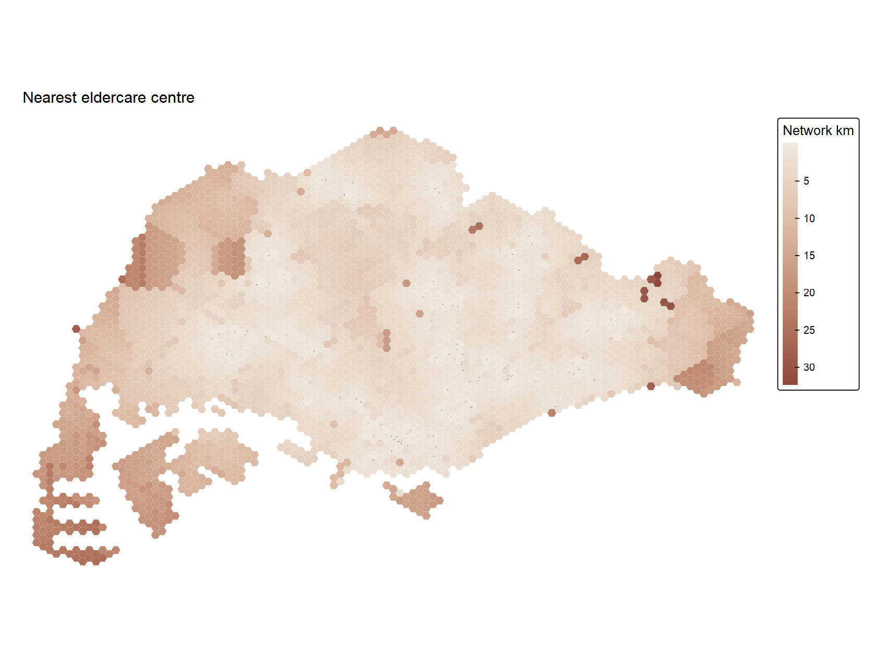
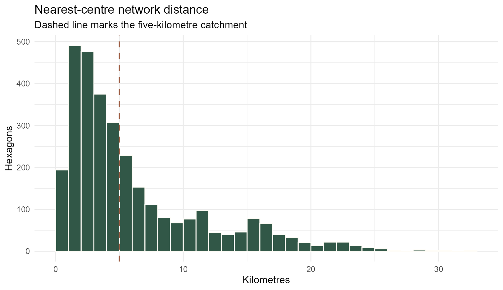
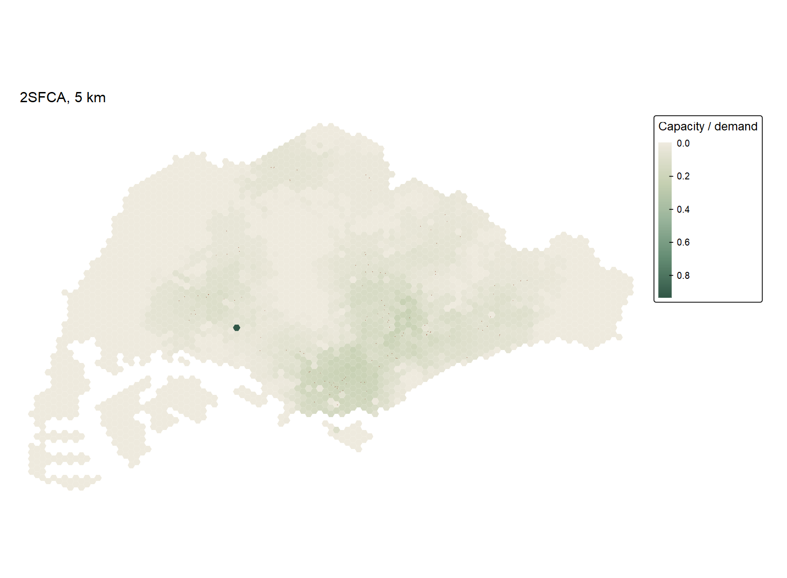
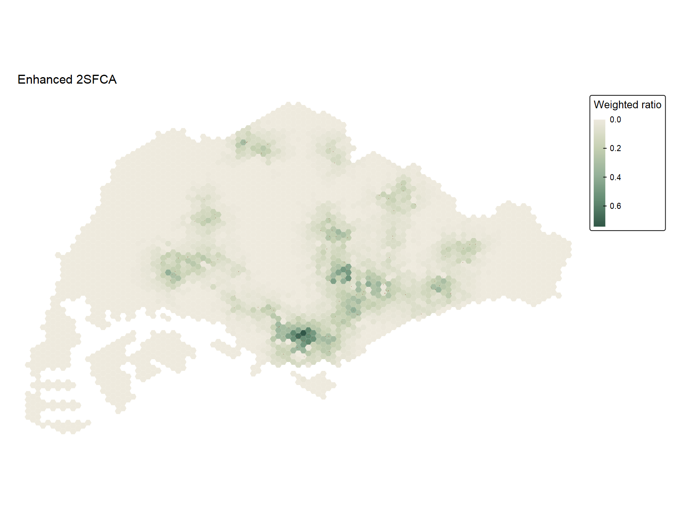
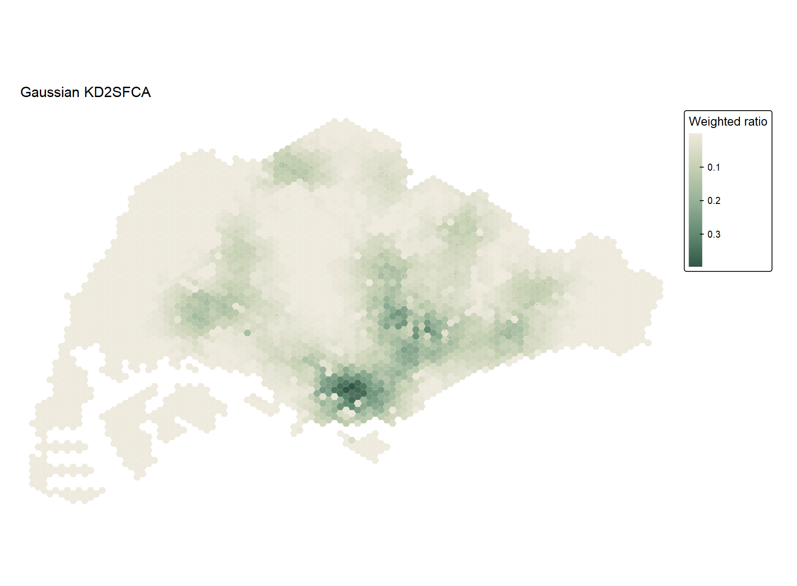
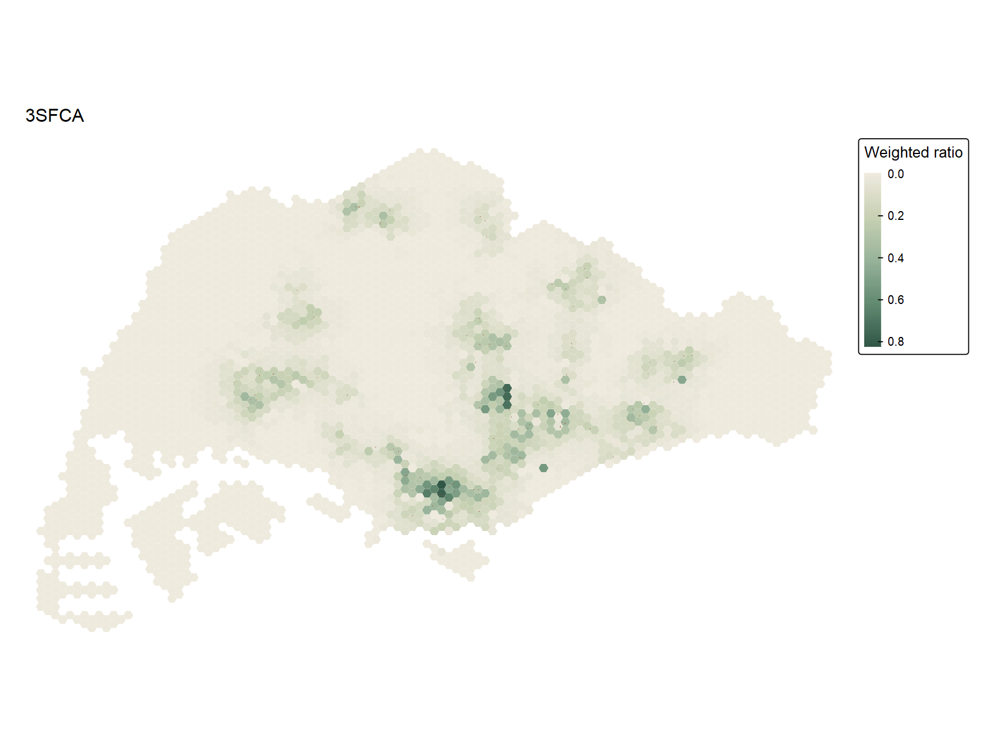
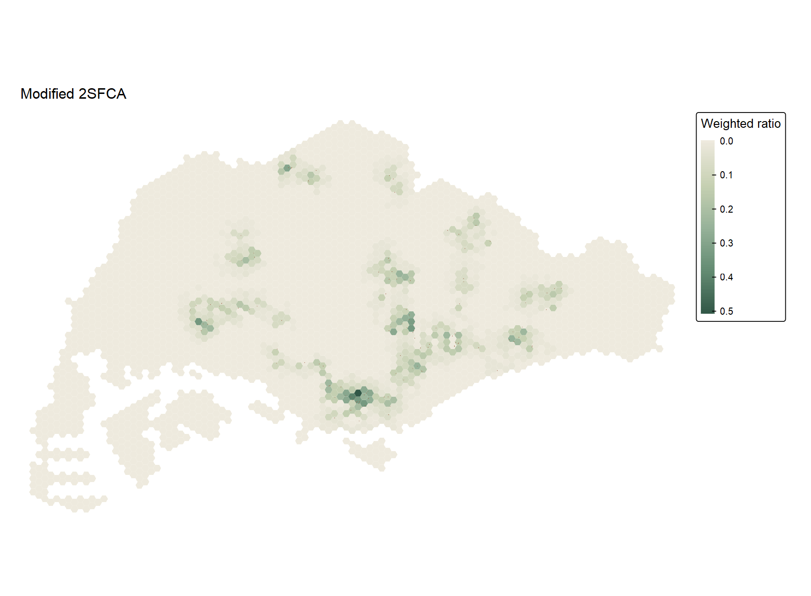
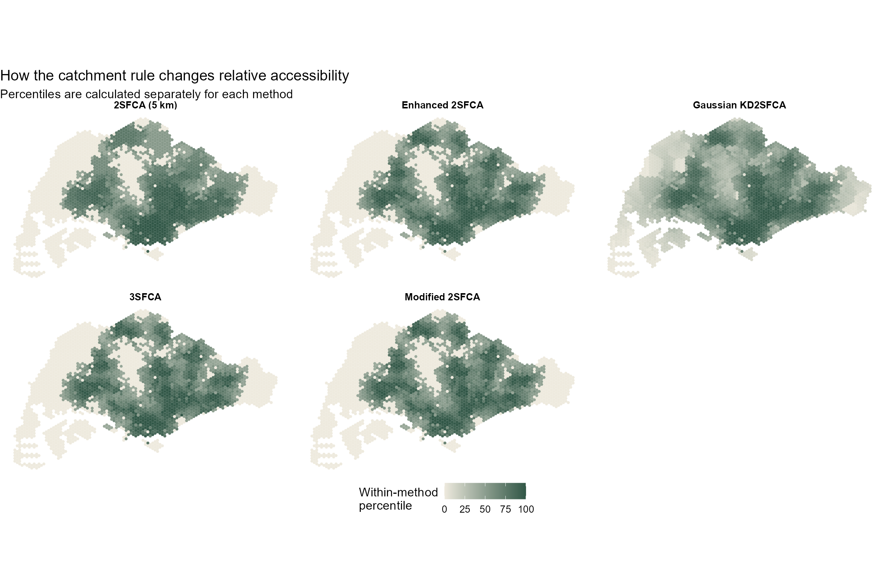
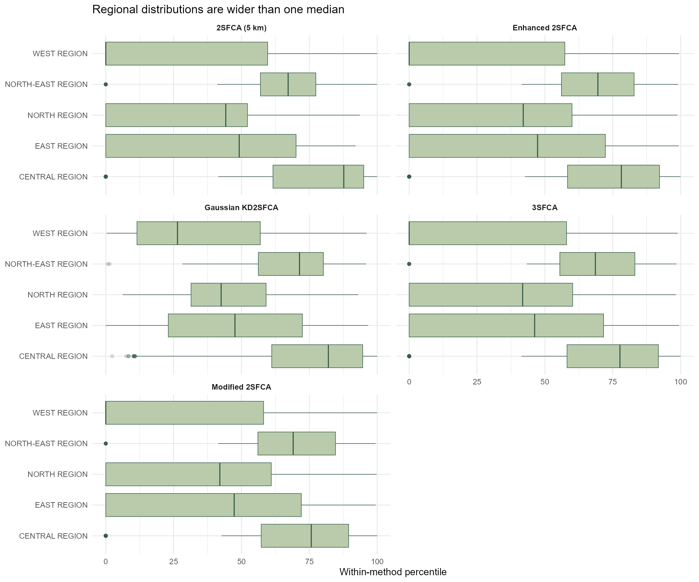

```{r}
#| include: false
source("In-class_Ex/In-class_Ex07/analysis.R", encoding = "UTF-8")
```

## Question and materials

The [In-class Exercise 7 slides](https://isss626-ay2026-27aug.netlify.app/in-class_ex/in-class_ex07/in-class_ex07-accessibility#/title-slide) move from the nearest eldercare centre to five floating catchment area measures. I use their sequence and parameters to ask where accessibility is relatively high, and whether the answer changes when I introduce distance weights and competition for capacity. This page builds on [Hands-on Exercise 7](../../Hands-on_Ex/Hands-on_Ex07/Hands-on_Ex07.qmd), but it is a separate in-class analysis with its own complete [RStudio script](analysis.R).

I reused the ZIP supplied for Hands-on Exercise 7. It contains Master Plan 2014 subzones, 3,125 hexagon origins, 120 eldercare destinations and a 375,000-row network origin–destination (OD) table. As in class, every hexagon is assigned demand 100 and every centre capacity 100. These are teaching assumptions, **not observed populations or licensed places**. The raw, course-prepared archive remains local; [reproduction notes](README.md) and the [input manifest](../../Hands-on_Ex/Hands-on_Ex07/outputs/input-manifest.csv) document it without republishing the data.

```{r}
#| echo: false
knitr::kable(audit07, col.names = c("Check", "Result"))
```

The shared preparation script checks that the OD matrix is complete and ordered correctly, repairs nine invalid subzone geometries, and records the metre-grid CRS as EPSG:3414. I convert network cost from metres to kilometres only after validating the OD pairs. A matrix with the correct dimensions but mismatched row IDs would produce plausible-looking, wrong maps.

## Distance to the nearest centre

The slide's `cost_to_closest()` example passes hexagon demand as `land_use_data`. I changed that argument to the eldercare table: the OD destinations are centres, so the opportunity column must describe centres. The resulting distance agrees exactly with the row minimum of the independent OD matrix check.

```{r}
#| eval: false
#| code-fold: show
travel <- od |>
  dplyr::transmute(from_id = origin_id,
                   to_id = destination_id,
                   dist = total_cost)
centres <- eldercare |>
  sf::st_drop_geometry() |>
  dplyr::transmute(id = fid, capacity = 100)
nearest <- accessibility::cost_to_closest(
  travel_matrix = travel,
  land_use_data = centres,
  opportunity = "capacity",
  travel_cost = "dist",
  n = 1
)
```

{fig-alt="Singapore hexagon map in warm copper colours; darker western and peripheral hexagons are farther from the nearest eldercare centre by network distance."}

The median nearest-centre distance is `r round(median(scores07$nearest_km), 2)` km and the longest is `r round(max(scores07$nearest_km), 1)` km. The Central Region median is `r round(region07$median_nearest_km[region07$REGION_N == "CENTRAL REGION"], 2)` km, compared with `r round(region07$median_nearest_km[region07$REGION_N == "WEST REGION"], 2)` km in the West. The histogram shows why five kilometres is consequential rather than a neutral default.

{fig-alt="Histogram of nearest-centre distances in kilometres; a dashed vertical line marks five kilometres."}

## Preparing the OD cost matrix

`catchment::catchment_ratio()` expects one distance for every origin–destination pair. The supplied costs are metres; the model distances are kilometres. I pivot the long OD table, then align its rows and columns to the `fid` order in the hexagon and centre layers. The analysis script checks both ID vectors before using the matrix.

```{r}
#| eval: false
wide <- od |>
  dplyr::select(origin_id, destination_id, total_cost) |>
  tidyr::pivot_wider(names_from = destination_id,
                     values_from = total_cost)
wide <- wide[match(hexagons$fid, wide$origin_id), ]
distance_km <- as.matrix(wide[, as.character(eldercare$fid)]) / 1000
stopifnot(identical(dim(distance_km), c(3125L, 120L)))
```

## Two-step floating catchment area (2SFCA)

The first ratio uses a five-kilometre limit. In the first step, each centre's assumed capacity is related to demand in its catchment. In the second, an origin accumulates ratios for centres it can reach. This adds competition for the same assumed supply; it is not simply a count of nearby centres.

```{r}
#| eval: false
two_sfca <- catchment::catchment_ratio(
  consumers = rep(100, nrow(hexagons)),
  providers = rep(100, nrow(eldercare)),
  cost = distance_km,
  max_cost = 5
)
```

{fig-alt="Singapore hexagon map of five-kilometre 2SFCA scores with a continuous green scale."}

`r format(sum(two07 == 0), big.mark = ",")` origins have no centre inside the five-kilometre network catchment and receive zero. The ratio's median is `r signif(median(two07), 3)`. I use a continuous legend rather than the slides' ten quantile classes: the large mass of tied zeros makes quantile cut-points repeat and can produce misleading labels.

## Enhanced 2SFCA: stepped distance decay

Enhanced 2SFCA keeps the five-kilometre outer boundary but assigns lower weights to more distant pairs. I use the slide's weights: 1 through the first kilometre, 0.4 to two kilometres, 0.1 to three, 0.05 to four and 0.01 to five.

```{r}
#| eval: false
step_weights <- list(c(5, .01), c(4, .05), c(3, .1),
                     c(2, .4), c(1, 1))
enhanced <- catchment::catchment_ratio(
  consumers = demand, providers = capacity,
  cost = distance_km, weight = step_weights
)
```

{fig-alt="Singapore hexagon map of enhanced 2SFCA scores, using the class exercise's stepped distance decay."}

The median falls to `r signif(median(enhanced07), 3)`, but changing the weights does not remove the 1,281 no-centre origins. This is a change in the model's allocation of opportunity inside the boundary, not a discovery of new service capacity.

## Gaussian kernel-density 2SFCA

The Gaussian version replaces steps with a smooth decline in influence. I state `scale = 2` explicitly so its kilometre interpretation is reproducible. Unlike the four bounded variants here, this call has **no hard maximum distance**. Every origin gets a mathematically positive value, even when that value is negligible.

```{r}
#| eval: false
gaussian <- catchment::catchment_ratio(
  consumers = demand, providers = capacity,
  cost = distance_km, weight = "gaussian", scale = 2
)
```

{fig-alt="Singapore hexagon map of Gaussian kernel-density 2SFCA scores, without a hard catchment cutoff."}

The smallest score is `r format(min(gaussian07), scientific = TRUE, digits = 2)`. Calling that non-zero value meaningful coverage would be misleading. The Gaussian map is smoother at catchment edges, but it still relies on the same synthetic demand and capacity inputs.

## Three-step floating catchment area (3SFCA)

The 3SFCA call uses the stepped weights and normalises each origin's weights across reachable providers. This models a choice or competition adjustment when more than one centre is within range. The five-kilometre outer boundary remains.

```{r}
#| eval: false
three_sfca <- catchment::catchment_ratio(
  consumers = demand, providers = capacity,
  cost = distance_km, weight = step_weights,
  normalize_weight = TRUE
)
```

{fig-alt="Singapore hexagon map of 3SFCA scores using normalized stepped catchment weights."}

## Modified 2SFCA

Finally, the modified 2SFCA squares the provider-side distance weights, following the slide. This makes proximity matter more strongly on that side of the ratio. It has a median score of `r signif(median(modified07), 3)`, but its raw values should not be read against 2SFCA or 3SFCA as if the scales were identical.

```{r}
#| eval: false
modified <- catchment::catchment_ratio(
  consumers = demand, providers = capacity,
  cost = distance_km, weight = step_weights,
  adjust_providers = function(w) w^2
)
```

{fig-alt="Singapore hexagon map of modified 2SFCA scores using squared provider-side distance weights."}

## Comparing the results

```{r}
#| echo: false
knitr::kable(summary07, digits = 4,
             col.names = c("Measure", "Minimum", "Median",
                           "90th percentile", "Maximum", "Zeros"))
```

{fig-alt="Five small-multiple maps showing each catchment method's own accessibility percentiles across Singapore."}

The percentiles compare *where* each method ranks origins higher, not the numerical units of the scores. Enhanced 2SFCA and 3SFCA have a Spearman rank correlation of `r round(correlation07["Enhanced_2SFCA", "Three_SFCA"], 3)`, yet their medians differ. The broad pattern is stable, but the calculations are not interchangeable. The Gaussian variant has no exact zeros; the other four all have `r sum(two07 == 0)` because they retain the five-kilometre limit.

{fig-alt="Boxplots by Singapore planning region and catchment method, with percentile on a common 0–100 scale."}

```{r}
#| echo: false
knitr::kable(region07[, c("REGION_N", "hexagons", "median_nearest_km",
                           "zero_2sfca", "median_2sfca")], digits = 3,
             col.names = c("Region", "Hexagons", "Median nearest km",
                           "Zero 2SFCA", "Median 2SFCA"))
```

Regional summaries are descriptive. For example, the West contains `r region07$zero_2sfca[region07$REGION_N == "WEST REGION"]` zero-score origins under the five-kilometre rule, but there is also considerable variation within regions. Seventeen hexagon representative points fall outside the supplied subzone-region polygons. I retain them on every map and exclude them only from the regional table.

## What I learned

This exercise clarified why nearest-centre distance and catchment ratios answer different questions. The first measures the network cost of reaching one destination. The ratio methods add a model of how limited capacity is shared among potential demand locations. The strongest practical lesson was to inspect the OD IDs before calling a function: using hexagon demand as the destination opportunity can return a number while answering the wrong question.

I also saw how much an edge rule matters. Four methods classify the same 1,281 origins as outside the five-kilometre catchment; Gaussian weighting assigns them tiny positive values instead. The large difference between zero and almost zero on a map is mostly a modelling choice here. Before interpreting these results as service adequacy, I would need the spatial distribution of older residents, actual centre capacities, eligibility, travel modes and travel times. Nothing in these maps establishes a causal effect of centre location on access or wellbeing.

## Sources and files

- [In-class Exercise 7 slides: *Geography of Accessibility: catchment methods*](https://isss626-ay2026-27aug.netlify.app/in-class_ex/in-class_ex07/in-class_ex07-accessibility#/title-slide), accessed 17 October 2026.
- [`catchment::catchment_ratio()` reference](https://uva-bi-sdad.github.io/catchment/reference/catchment_ratio.html) and [package introduction](https://uva-bi-sdad.github.io/catchment/articles/introduction.html), accessed 17 October 2026.
- [`accessibility::cost_to_closest()` reference](https://search.r-project.org/CRAN/refmans/accessibility/html/cost_to_closest.html), accessed 17 October 2026.
- User-supplied `Hands-on Exercise 7.zip`, received 17 October 2026. The archive does not identify a separate source date or publisher for every prepared layer. See the [input manifest](../../Hands-on_Ex/Hands-on_Ex07/outputs/input-manifest.csv), [method audit](outputs/input-and-model-audit.csv) and [session details](outputs/session-info.txt).
- [Full RStudio analysis script](analysis.R) · [Reproduction notes](README.md) · [Download a PNG map](figures/nearest-centre.png).
