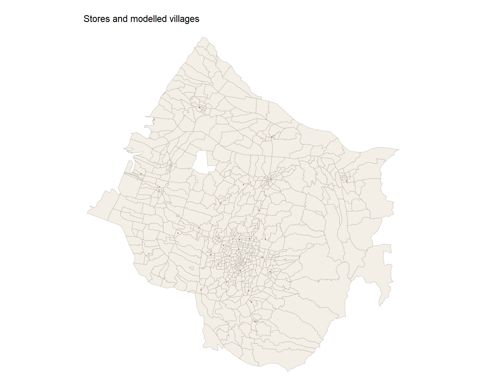
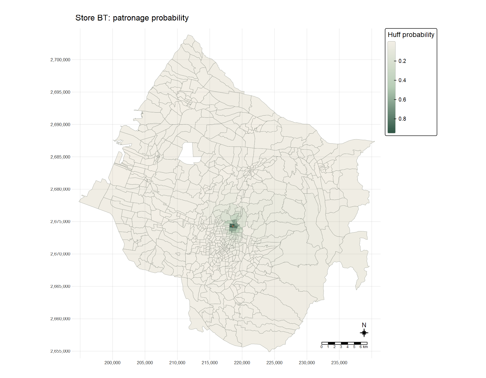
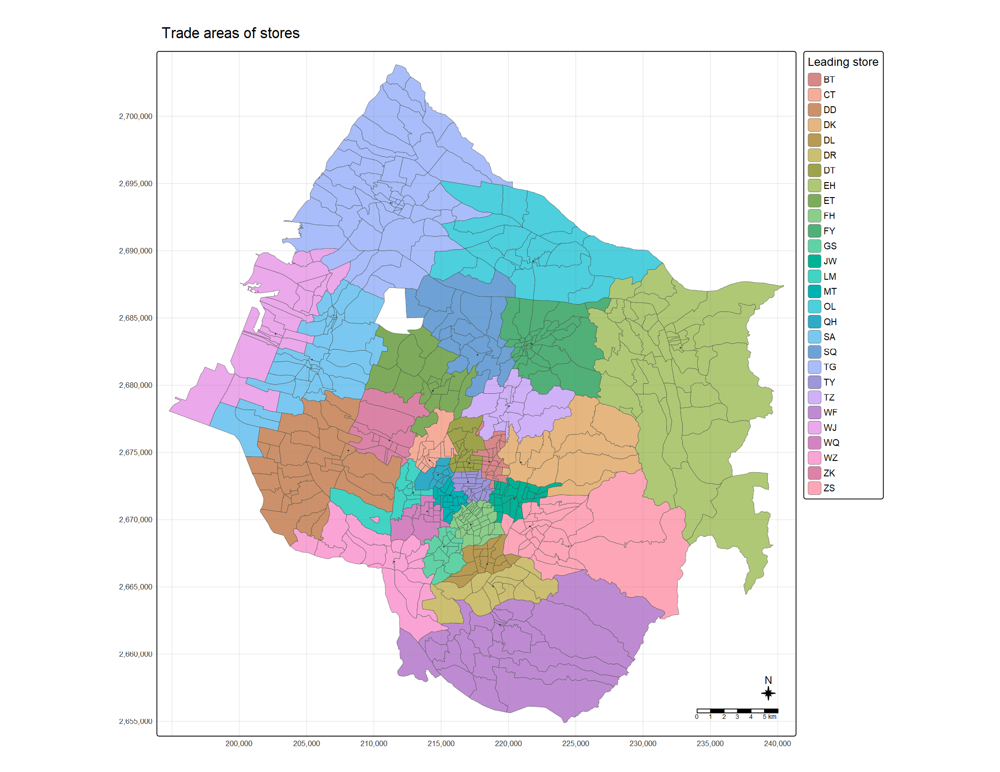
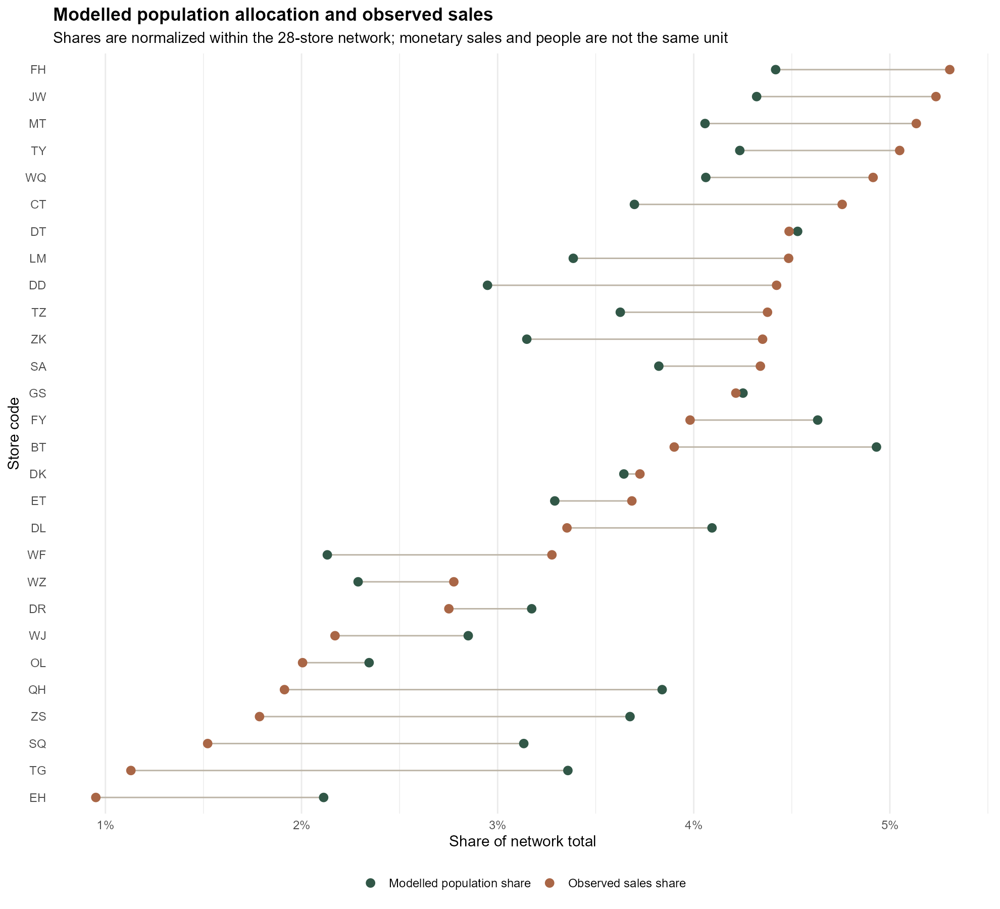

```{r}
#| include: false
source("In-class_Ex/In-class_Ex08/analysis.R", encoding = "UTF-8")
```

## Question and materials

I followed the sequence in [Chapter 18, Retail Trade Area Analysis](https://r4gdsa.netlify.app/chap18): prepare village demand and store supply, calculate a distance matrix, estimate Huff probabilities, and aggregate expected customers. The class screenshot adds one useful final step: assigning each village to its highest-probability store and drawing a trade-area map. My question is how much geography alone can explain the allocation of demand across this 28-store network.

The inputs come from the course-provided `Hands-on_Ex08.zip` (received 28 October 2026): `STORES_TC`, `TOWN_TC` and `VILLAGE_TC` shapefiles, 2019 village population, and a store-sales table. The shapefiles are in TWD97 / TM2 zone 121 (EPSG:3826), whose coordinates are measured in metres. I do not republish the raw ZIP because its redistribution terms were not provided. The [complete RStudio analysis script](analysis.R), [preparation script](prepare.R), [reproduction notes](README.md), [input checks](outputs/input-audit.csv) and [SHA-256 input manifest](outputs/input-manifest.csv) are available with this page. The sales observation period is not documented in the supplied file, so I do not label its totals as 2019 sales.

```{r}
#| echo: false
knitr::kable(audit08, col.names = c("Input check", "Result"))
```

Five of the 622 village polygons lack a matched, positive population record and are left out of the model. The store-sales file contains 234 distinct codes, but only 28 match the modelled network; other codes are not counted as the network's sales. These exclusions matter when interpreting the predicted and observed shares.

## Preparing village demand and store supply

I remove hyphens from the population table's `V_ID` before joining it to `VILLCODE`. I aggregate sales by store code before joining the 28 store features, rather than allowing repeated transaction rows to duplicate spatial features. Following the workbook's teaching setting, each store gets the same attractiveness value, 100. This is **not a measured store floor area**; it deliberately makes the allocation depend on distance alone.

```{r}
#| eval: false
#| code-fold: show
pop <- readr::read_csv("data/aspatial/pop2019.csv") |>
  dplyr::mutate(V_ID = gsub("-", "", V_ID, fixed = TRUE))
sales <- readr::read_csv("data/aspatial/Store_sales_data.csv") |>
  dplyr::group_by(`Store Code`) |>
  dplyr::summarise(Total_Sales = sum(Amount, na.rm = TRUE),
                   .groups = "drop")
village <- dplyr::left_join(village_sf, pop,
                            by = dplyr::join_by(VILLCODE == V_ID)) |>
  dplyr::filter(!is.na(P_CNT), P_CNT > 0)
stores <- dplyr::left_join(stores_sf, sales,
                           by = dplyr::join_by(Store_CD == `Store Code`)) |>
  dplyr::mutate(Store_size = 100)
```

The excerpt shows the join logic; the [running preparation script](prepare.R) supplies the explicit file paths, key checks, CRS assertion and input manifest.

{fig-alt="Map of Taichung village polygons in warm neutral colour with 28 store points in copper."}

## Building the village–store distance matrix

For each village I use `st_point_on_surface()` to get an origin point inside its polygon. `st_distance()` in EPSG:3826 gives straight-line distances in metres. After pivoting the matrix, I check there is exactly one row for each village–store pair: `r format(nrow(distance08), big.mark = ",")` rows in all. A point on the polygon is a convenient spatial proxy, not a household address, and straight-line distance is not road travel time.

```{r}
#| eval: false
#| code-fold: show
origins <- sf::st_point_on_surface(village)
distance_matrix <- units::drop_units(sf::st_distance(origins, stores))
# Pivot to VILLCODE, Store_CD and distance; then verify every pair is unique.
```

## Huff probabilities and the BT example

I use the [MCI package's `huff.shares()`](https://search.r-project.org/CRAN/refmans/MCI/html/MCI-package.html) with attraction exponent `gamma = 1` and distance exponent `lambda = -2`. The probability that village \(i\) chooses store \(j\) is

\[
p_{ij}=\frac{A_j^\gamma d_{ij}^\lambda}
{\sum_k A_k^\gamma d_{ik}^\lambda}.
\]

With every \(A_j=100\), this is a normalized inverse-square distance model. The script independently recomputes that formula and verifies that the 28 probabilities for each village sum to one.

```{r}
#| eval: false
#| code-fold: show
huff <- MCI::huff.shares(interaction,
                         "VILLCODE", "Store_CD", "Store_size", "distance",
                         gamma = 1, lambda = -2)
stopifnot(max(abs(dplyr::summarise(
  dplyr::group_by(huff, VILLCODE), total = sum(p_ij))$total - 1)) < 1e-8)
```

{fig-alt="Taichung village map shading the probability of patronising store BT from pale neutral to dark forest green, concentrated near BT's central-southern location."}

The median local probability for BT is `r scales::percent(median(bt08$p_ij), accuracy = 0.1)`. That low median does not mean BT is weak in its immediate neighbourhood: its darker catchment is compact, while the many distant villages dilute the citywide median. This is a *modelled choice probability*, not observed customer movement.

## Assigning the leading store

The class screenshot shows a categorical map of trade areas. I assign each village to the store with its largest \(p_{ij}\), breaking any ties by store code. In the equal-size version of the Huff model, this is exactly the nearest store; the analysis script checks that identity against the distance matrix. The median leading-store probability is `r scales::percent(median(winner08$Leading_probability), accuracy = 0.1)`, so a coloured village is not necessarily an exclusive or even majority market for its leading store.

{fig-alt="Taichung village polygons coloured by leading store code, with store points, 28-code legend, north arrow, scale bar and coordinate grid."}

This map follows the screenshot's trade-area composition, but the coloured boundaries should not be mistaken for barriers to cross-shopping. The underlying probabilities still spread every village's demand across all 28 stores.

## Expected customers and observed sales shares

`shares.total()` weights each village's probabilities by its population. The resulting `sum_E_j` values are **expected people**, not sales in currency. I verified their sum equals the `r format(sum(village08$P_CNT), big.mark = ",")` people represented by the matched villages. To compare like with like as far as the data allow, I divide each store's modelled people by total modelled people and each store's sales by total sales *within the same 28-store network*. The comparison is of relative shares, not equivalent units or a formal validation against customer counts.

{fig-alt="Horizontal dumbbell chart for 28 stores; forest dots show modelled population shares and copper dots show sales shares, with several clear gaps between them."}

The two share rankings have a Spearman correlation of `r round(rank_rho08, 3)`, while the mean absolute store-level difference is `r round(mae_pp08, 2)` percentage points. For example, TG's modelled share is `r scales::percent(store_compare08$Predicted_share[store_compare08$Store_CD == "TG"], accuracy = 0.1)` against `r scales::percent(store_compare08$Observed_share[store_compare08$Store_CD == "TG"], accuracy = 0.1)` of network sales. The gap is worth investigating, but I cannot attribute it to store performance: equal attractiveness, straight-line distance, spending per customer and the unknown sales period can all contribute.

```{r}
#| echo: false
knitr::kable(
  store_compare08 |>
    dplyr::mutate(abs_gap = abs(Gap_pp)) |>
    dplyr::slice_max(abs_gap, n = 6) |>
    dplyr::select(Store_CD, Predicted_share, Observed_share, Gap_pp),
  digits = 3,
  col.names = c("Store", "Modelled share", "Sales share", "Gap (pp)")
)
```

## A small distance-decay sensitivity check

I recalculated the model with distance exponents of −1, −2 and −3 while keeping the equal store sizes. BT's median *local* probability changes substantially, but its population-weighted network share remains close to five per cent. More generally, the leading-store assignments do not change here: with identical attractiveness, any negative exponent still ranks stores by distance. This is a check on model specification, not an estimate of the true customer-choice exponent.

```{r}
#| echo: false
knitr::kable(sensitivity08, digits = 4,
             col.names = c("Distance exponent", "BT weighted share",
                           "BT median village probability"))
```

## What I learned

The most useful distinction for me was between a *probability surface* and a *trade-area label*. The BT map retains the gradual decline and competition, while the 28-colour map compresses each village to one winner. With equal store size, that colourful result is ultimately a nearest-store map; it does not reveal a separately estimated commercial pull.

The second lesson was about units. Multiplying village population by Huff probabilities produces an allocation of people, not a revenue forecast. Normalized shares permit a cautious comparison with the sales table, but they do not control for spending, store scale, transport links or temporal mismatch. A stronger follow-up would use measured store area or transaction counts by origin, road-network travel times, and an estimated distance-decay parameter before judging the model's predictive value.

## Sources

- [R for Geospatial Data Science and Analytics, Chapter 18: Retail Trade Area Analysis](https://r4gdsa.netlify.app/chap18) — analytical sequence and Huff-model teaching settings.
- [MCI package documentation](https://search.r-project.org/CRAN/refmans/MCI/html/MCI-package.html) — Huff share and total functions.
- Course-provided `Hands-on_Ex08.zip`, received 28 October 2026 — Taichung stores, villages, population and sales. The [manifest](outputs/input-manifest.csv) records exact input hashes; the raw data are not redistributed.
