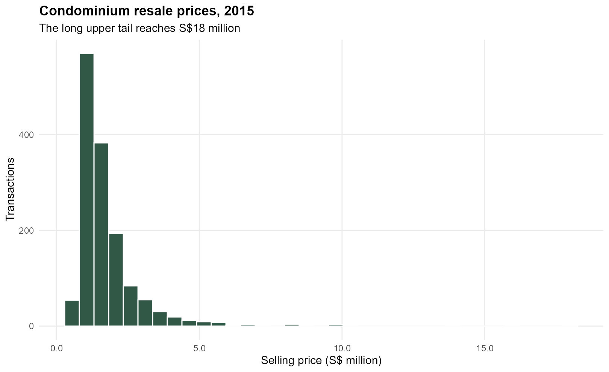
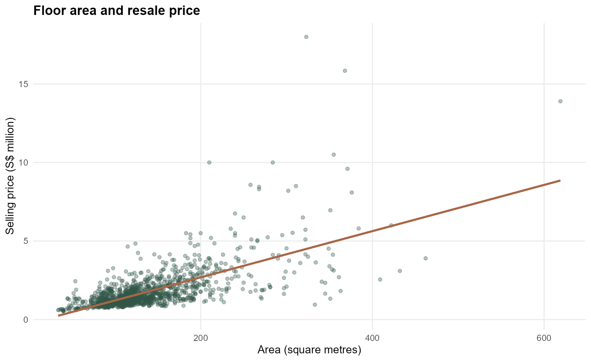
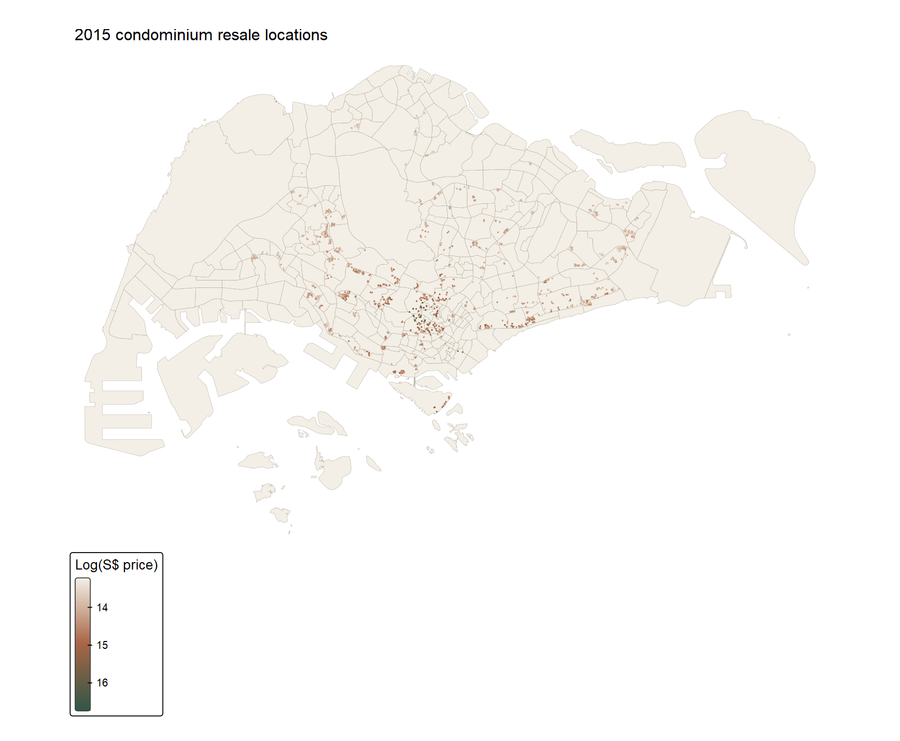
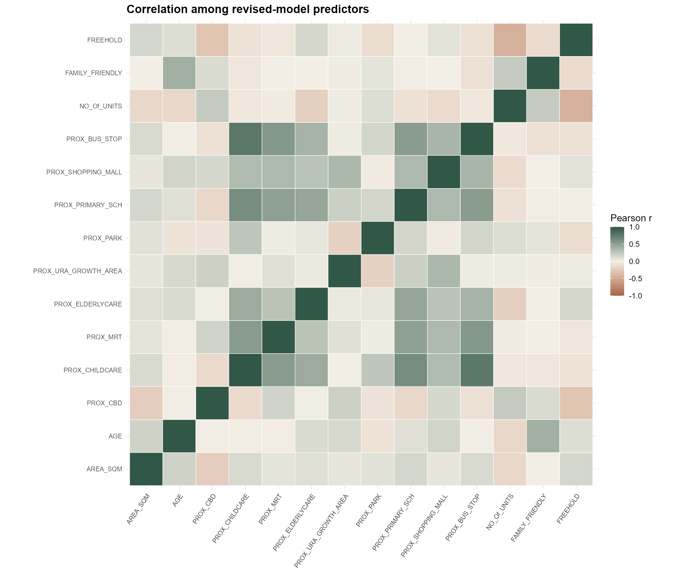
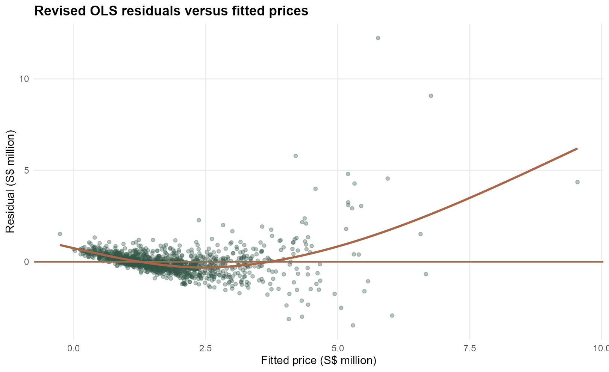
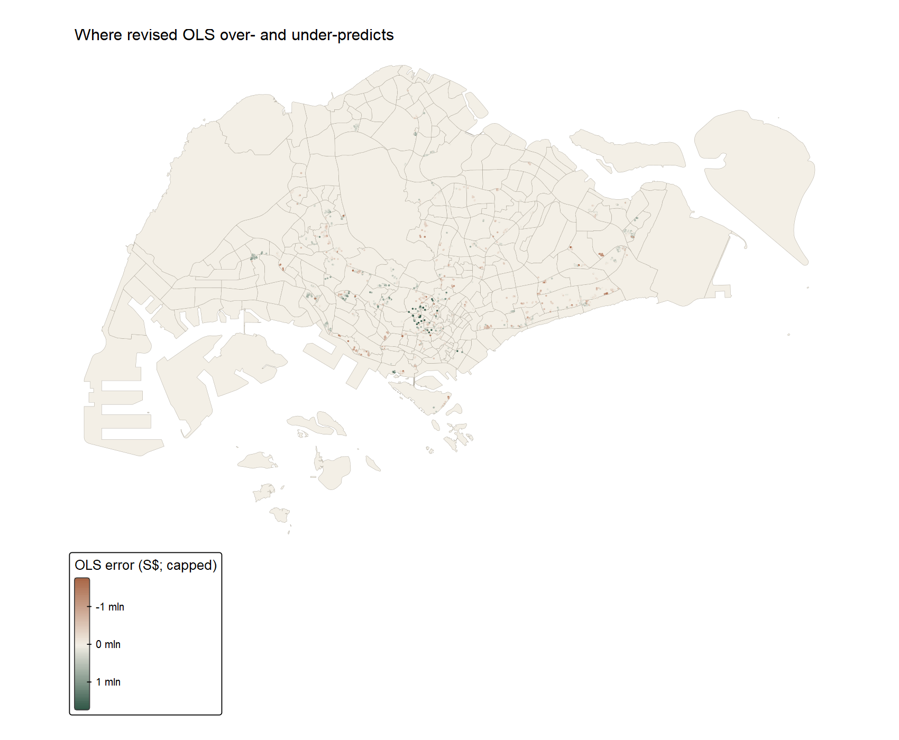
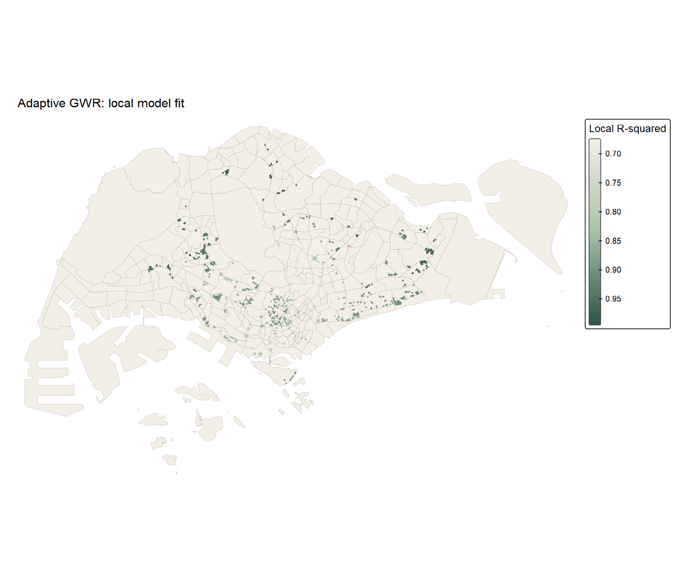
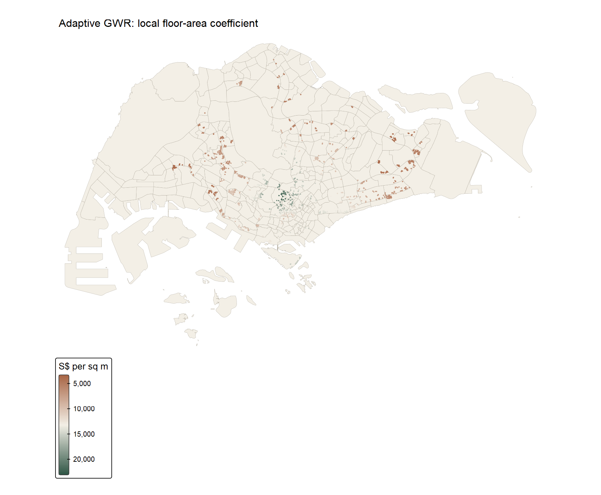

```{r}
#| include: false
source("In-class_Ex/In-class_Ex09/analysis.R", encoding = "UTF-8")
```

## Aim and data

I followed the sequence in [Chapter 13, *Calibrating Hedonic Pricing Model for Private Highrise Property with GWR Method*](https://r4gdsa.netlify.app/chap13.html): prepare spatial and transaction data, inspect the outcome and predictors, fit global hedonic regressions, check their residuals, then compare fixed and adaptive geographically weighted regression (GWR). The practical question is whether one set of price coefficients describes the whole 2015 resale sample adequately.

The course-provided `Hands-on_Ex09.zip` contains 2015 condominium resale records and the Master Plan 2014 subzone shapefile. I used the archive found on the Desktop on 31 October 2026. It contains no data dictionary or redistribution permission, so I do not publish the raw files. The [RStudio analysis script](analysis.R), [data preparation script](prepare.R), [reproduction guide](README.md), [input audit](outputs/input-audit.csv) and [SHA-256 manifest](outputs/input-manifest.csv) let a reader check what was used.

```{r}
#| echo: false
knitr::kable(audit09, col.names = c("Input check", "Result"))
```

The polygon file identifies its coordinate system as SVY21 but has no numeric EPSG identifier. After repairing nine invalid polygons, I transform it to EPSG:3414. The transaction longitude and latitude fields are WGS84 coordinates, which I transform from EPSG:4326 to the same metre-based system. All 1,436 records fall inside the subzone union. I retain the 69 records at repeated coordinates: they can represent separate sales at one property, and deleting them would change the transaction sample without evidence of duplication.

```{r}
#| eval: false
subzones <- sf::st_read("data/geospatial/MP14_SUBZONE_WEB_PL.shp") |>
  sf::st_make_valid() |>
  sf::st_transform(3414)
condo <- readr::read_csv("data/aspatial/Condo_resale_2015.csv") |>
  sf::st_as_sf(coords = c("LONGITUDE", "LATITUDE"), crs = 4326) |>
  sf::st_transform(3414)
```

The excerpt shows the core transformations; [the running script](prepare.R) supplies project-relative paths and validation checks.

## Exploring prices and locations

{fig-alt="Histogram of 1,436 condominium resale transactions with a long right tail reaching S$18 million."}

The median sale is S$`r format(round(median(condo09$SELLING_PRICE)), big.mark = ",")`, while the maximum is S$`r format(max(condo09$SELLING_PRICE), big.mark = ",")`. This long upper tail matters for a level-price regression: a few very expensive homes can have disproportionate influence. I calculate a log-price field for exploratory checking, but keep the workbook's level-price outcome for the main OLS–GWR comparison so the models remain on the same scale.

{fig-alt="Scatterplot of area in square metres against resale price in S$ million, with a positive OLS trend and several expensive outliers."}

{fig-alt="Singapore map with condominium transaction points coloured by log selling price over pale subzone polygons."}

The transactions are concentrated in developed parts of the island rather than spread uniformly across all 323 subzones. An empty subzone on this map is not evidence of low prices; it may simply have no transaction in this dataset. The interactive version below allows closer inspection of the points.

<iframe src="figures/transaction-interactive.html" title="Interactive map of 2015 condominium resales" style="width:100%;height:580px;border:1px solid #d7d1c5;border-radius:8px" loading="lazy"></iframe>

## From simple to multiple regression

The simple model relates sale price to floor area. The revised multiple model keeps the set of structural and proximity variables used in the chapter. I also fit the chapter's broader initial model to show how the revision changes model fit. `LEASEHOLD_99YR` is not entered alongside the intercept and the other tenure indicators. I do not treat a small p-value as proof that a proximity measure causes a price change: location, building quality and buyer selection can confound the associations.

```{r}
#| eval: false
simple <- lm(SELLING_PRICE ~ AREA_SQM, data = sf::st_drop_geometry(condo09))
revised <- lm(
  SELLING_PRICE ~ AREA_SQM + AGE + PROX_CBD + PROX_CHILDCARE +
    PROX_MRT + PROX_ELDERLYCARE + PROX_URA_GROWTH_AREA + PROX_PARK +
    PROX_PRIMARY_SCH + PROX_SHOPPING_MALL + PROX_BUS_STOP +
    NO_Of_UNITS + FAMILY_FRIENDLY + FREEHOLD,
  data = sf::st_drop_geometry(condo09)
)
```

```{r}
#| echo: false
knitr::kable(metric09[1:3, ], digits = 3,
             col.names = c("Model", "Records", "AICc", "R²",
                           "In-sample RMSE (S$)"))
```

Floor area alone explains `r scales::percent(summary(simple09)$r.squared, accuracy = 0.1)` of the sample price variation. The revised model explains `r scales::percent(summary(revised09)$r.squared, accuracy = 0.1)`. Its floor-area coefficient is about S$`r format(round(coef(revised09)["AREA_SQM"]), big.mark = ",")` per additional square metre and its age coefficient is about S$`r format(round(coef(revised09)["AGE"]), big.mark = ",")` per additional year, conditional on the other included fields. These are fitted sample associations, not isolated causal effects. The revised model has slightly lower AICc than the full one, even though its in-sample RMSE is marginally higher; adding variables can improve raw fit without sufficiently offsetting the complexity penalty.

{fig-alt="Square correlation heatmap for 14 structural and locational predictors, with copper for negative and forest green for positive correlations."}

The largest variance inflation factor in the revised model is `r round(max(vif_table09$VIF), 2)`. That does not remove all concern about local collinearity: GWR uses much smaller effective neighbourhoods than the global model, so its local coefficients can be less stable even when the global VIFs look moderate.

```{r}
#| echo: false
knitr::kable(vif_table09 |> dplyr::arrange(dplyr::desc(VIF)) |>
               dplyr::slice_head(n = 6), digits = 2,
             col.names = c("Predictor", "VIF"))
```

## Diagnosing the global model

{fig-alt="Scatterplot of OLS residuals against fitted resale prices, showing the zero line, a smooth trend and large positive outliers."}

The residual plot shows a long positive tail and a pattern that the linear model does not fully absorb. I therefore treat its conventional coefficient tests cautiously. A log-price model is a useful alternative to explore, but it changes coefficient interpretation and cannot be compared with the level-price model by directly reading their AICc values.

{fig-alt="Singapore map of OLS errors at transaction locations, using a diverging copper-to-forest scale capped symmetrically for visual display."}

For the map only, I cap residual colours symmetrically at the 98th percentile of absolute errors, about S$`r format(round(residual_cap09), big.mark = ",")`. The regression and spatial test use the uncapped errors. Without this display cap, the S$12.2 million maximum positive residual would flatten nearly all other map colours.

Following the chapter, I define neighbours within 1,500 metres using projected coordinates and row-standardised weights. The graph has `r spdep::n.comp.nb(neighbours09)$nc` disconnected components but no isolated transaction. I use 499 permutations and an explicitly two-sided, plus-one Monte Carlo comparison. Its smallest attainable p-value is 0.002, not zero.

```{r}
#| eval: false
nb <- spdep::dnearneigh(sf::st_coordinates(condo), 0, 1500)
wt <- spdep::nb2listw(nb, style = "W", zero.policy = TRUE)
set.seed(20261031)
test <- spdep::moran.mc(residuals(revised), wt, nsim = 499,
                        alternative = "two.sided", zero.policy = TRUE)
# The running script computes a plus-one rank p-value from test$res.
```

```{r}
#| echo: false
knitr::kable(moran_table09[, c("model", "Moran_I", "Monte_Carlo_p")],
             digits = 3,
             col.names = c("Residual set", "Moran's I", "Two-sided Monte Carlo p"))
```

The revised OLS residual Moran's I is `r round(moran_table09$Moran_I[1], 3)` with p = `r format(moran_table09$Monte_Carlo_p[1], nsmall = 3)`. Nearby model errors are more similar than a random permutation would usually produce under this neighbour definition. This is evidence of remaining spatial structure, not proof that one specific omitted variable caused it.

## Fixed and adaptive GWR

I use the same revised formula and same records for both local models. The chapter's Gaussian kernel and leave-one-out cross-validation choose a fixed distance bandwidth of `r round(bw_fixed09)` metres and an adaptive bandwidth of `r round(bw_adaptive09)` nearest observations. The latter grows its geographical reach where transactions are sparse and contracts in dense areas. Both distances are computed in EPSG:3414, so the fixed value is metres, not degrees.

```{r}
#| eval: false
bw_fixed <- GWmodel::bw.gwr(revised_formula09, data = sf_sp09,
                            approach = "CV", kernel = "gaussian",
                            adaptive = FALSE, longlat = FALSE)
fixed <- GWmodel::gwr.basic(revised_formula09, data = sf_sp09,
                            bw = bw_fixed, kernel = "gaussian",
                            adaptive = FALSE, longlat = FALSE)
bw_adaptive <- GWmodel::bw.gwr(revised_formula09, data = sf_sp09,
                               approach = "CV", kernel = "gaussian",
                               adaptive = TRUE, longlat = FALSE)
adaptive <- GWmodel::gwr.basic(revised_formula09, data = sf_sp09,
                               bw = bw_adaptive, kernel = "gaussian",
                               adaptive = TRUE, longlat = FALSE)
```

```{r}
#| echo: false
knitr::kable(metric09[c(3, 4, 5), ], digits = 3,
             col.names = c("Model", "Records", "AICc", "R²",
                           "In-sample RMSE (S$)"))
```

The adaptive GWR has a lower AICc (`r round(metric09$AICc[5])`) than both fixed GWR (`r round(metric09$AICc[4])`) and revised OLS (`r round(metric09$AICc[3])`). Its in-sample RMSE is about S$`r format(round(metric09$RMSE_in_sample[5]), big.mark = ",")`, against S$`r format(round(metric09$RMSE_in_sample[3]), big.mark = ",")` for OLS. This is a substantial improvement in *fit* on the transactions used to calibrate the models. It is not an independent forecast test: flexible local regressions can fit the observed locations closely, and a new-place or future-sale assessment needs spatially separated validation.

{fig-alt="Singapore transaction-point map shaded by local R-squared of the adaptive geographically weighted regression."}

The median local R² is `r round(median(local09$Local_R2), 3)`, but the 10th and 90th percentiles range from `r round(quantile(local09$Local_R2, .1), 3)` to `r round(quantile(local09$Local_R2, .9), 3)`. The map identifies where the model fits the 2015 observations differently. It does not mean the model is equally reliable at unobserved addresses.

{fig-alt="Singapore transaction-point map of the adaptive GWR floor-area coefficient in Singapore dollars per square metre, with visible spatial variation."}

The local floor-area coefficient stays positive in this fit. Its median is about S$`r format(round(median(local09$AREA_SQM)), big.mark = ",")` per square metre, with a 10th–90th percentile range of roughly S$`r format(round(quantile(local09$AREA_SQM, .1)), big.mark = ",")`–S$`r format(round(quantile(local09$AREA_SQM, .9)), big.mark = ",")`. That variation is interesting, but I would check local condition numbers and coefficient uncertainty before treating individual points as precise local valuations.

The adaptive GWR residual Moran's I is `r round(moran_table09$Moran_I[2], 3)` with a two-sided permutation p of `r format(moran_table09$Monte_Carlo_p[2], nsmall = 3)`. Its magnitude is much smaller than the OLS residual value, but the test still detects a slight negative pattern at the 1.5 km scale. I would not describe the residuals as fully spatially independent.

## What I learned

This exercise made the scale of a model comparison more concrete. Floor area is strongly associated with resale price, but it leaves much of the 2015 price variation unexplained. Adding the chapter's structural and accessibility fields helps; allowing coefficients to vary over space improves the fitted model further. The local map also shows why a single global “price per square metre” can conceal variation across the observed market.

I also learned to separate a model's fit from its evidential strength. The GWR bandwidth is selected from these same sales, and the local maps describe these same locations. The higher in-sample R² is not a promise of better predictions for a new development. Repeated coordinates, expensive outliers, disconnected neighbour components, and unknown construction of the proximity measures all limit interpretation. A next step would use spatially blocked holdouts, measured property attributes missing here, and a sensitivity analysis on the local bandwidth before making a valuation claim.

## Sources

- [R for Geospatial Data Science and Analytics, Chapter 13](https://r4gdsa.netlify.app/chap13.html) — exercise sequence, model formulas and Gaussian GWR settings.
- [Gollini et al. (2015), *GWmodel: An R Package for Exploring Spatial Heterogeneity Using Geographically Weighted Models*](https://www.jstatsoft.org/article/view/v063i17) — GWR methods and implementation.
- Course-provided `Hands-on_Ex09.zip`, accessed 31 October 2026 — 2015 resale CSV and Master Plan 2014 subzone boundary. Exact [input hashes](outputs/input-manifest.csv) are recorded; the raw archive is not redistributed.
