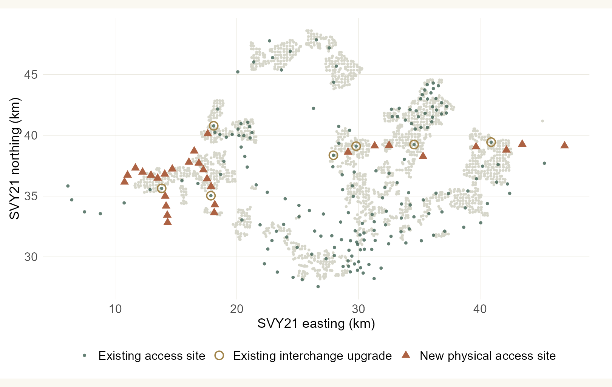
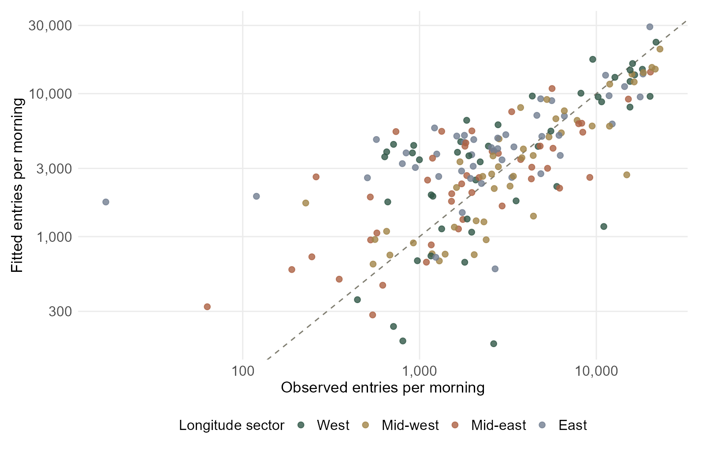
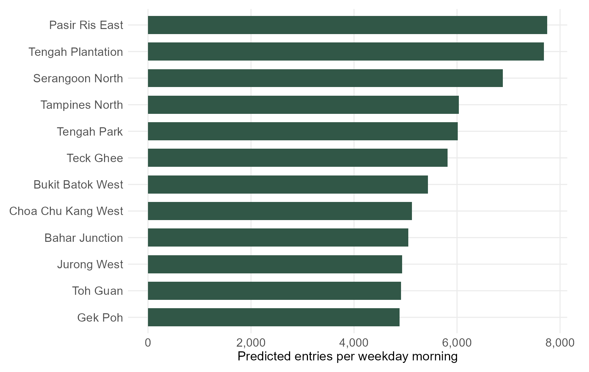
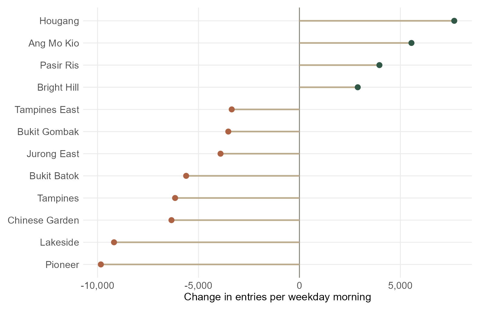
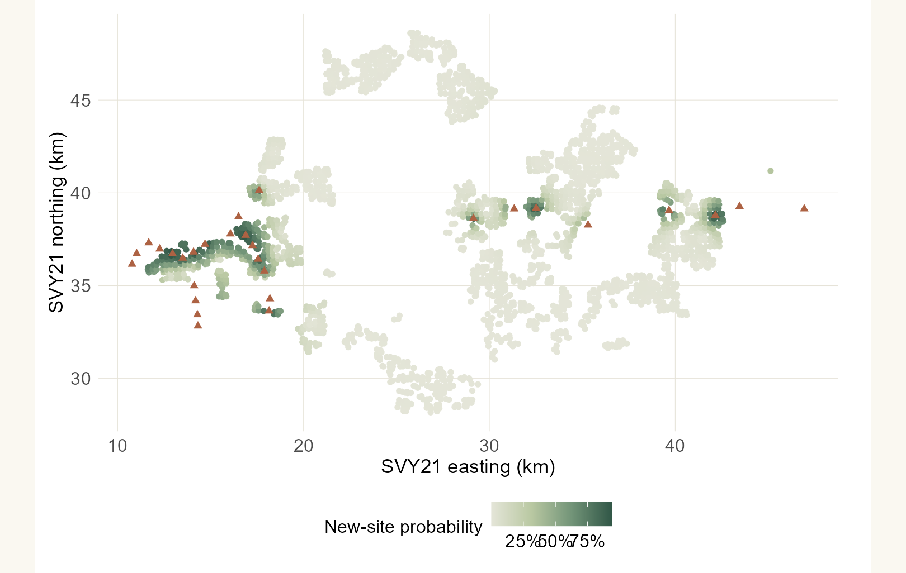
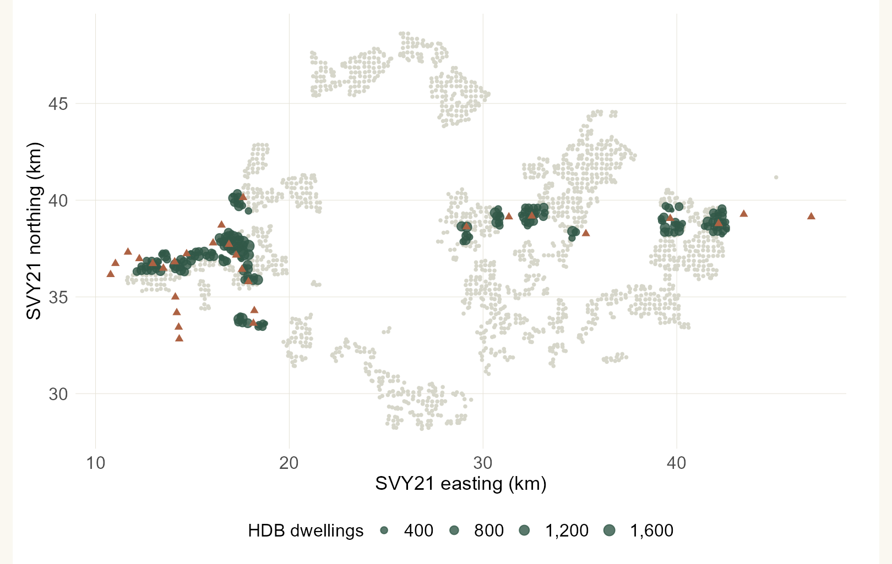

```{r}
#| include: false
s <- readRDS("Take-home_Ex/Take-home_Ex03/outputs/report-results.rds")
n <- function(x) format(round(x), big.mark = ",", trim = TRUE, scientific = FALSE)
pct <- function(x) paste0(round(100*x, 1), "%")
tval <- function(label) s$scenario_totals$value[match(label, s$scenario_totals$measure)]
aa <- subset(s$accessibility, threshold_m == 800)
nn <- subset(s$stations, status == "new")
top <- nn[which.max(nn$expanded_daily), ]
ee <- subset(s$stations, status == "existing")
loss <- ee[which.min(ee$change_daily), ]
```

## Contents

The question and evidence  
A calibrated station-choice model  
New access, redistributed demand and planning implications

## 1 · Which station—and whose access improves?

::: {.columns}
::: {.column width="64%"}
{height=430}
:::
::: {.column width="36%"}
**Research question**

How could the specified JRL and CRL1 stations redistribute weekday morning entries?

**181 existing sites → 210 sites**

29 new physical access sites; seven existing interchange upgrades.

The comparison holds the market fixed. It is a network scenario, not an official opening-year forecast.
:::
:::

## 2 · A morning market grounded in observed entries

- **`r n(s$settings$fixed_market)` entries** per weekday, 06:00–09:59, January 2026.
- LTA archive: 7,259 records, 182 raw station codes; Stevens' two codes become one site.
- **`r n(tval('Source HDB building origins'))` HDB buildings**, weighted by **`r n(tval('Dwelling market potential'))` dwellings**.
- Metre-based SVY21; 250 m origin grid; original building points for coverage checks.

::: {.takeaway}
An entry is a rail-system tap-in, not a unique passenger. Dwelling units proxy residential market potential; they do not observe individual rail choices.
:::

::: {.source}
Sources: LTA Jan 2026 public archive, pinned and hashed; LTA Sep 2026 station footprints; HDB Property Information and Existing Building; URA/LTA future coordinates. Accessed 1 Nov 2026.
:::

## 3 · Probability allows overlapping catchments

$$
P_{ij}\propto \text{lines}_j^{\beta}(d_{ij}+200\text{ m})^{-\alpha}
$$

- Every HDB origin can choose among all physical station sites.
- Distance discourages a choice; the number of rail lines proxies onward connectivity.
- Calibrate shared parameters to observed station shares, then apply them to the expanded network.
- Compare an equal-attraction model and hide each longitude sector's observed outcomes in turn.

::: {.takeaway}
Observed ridership is the calibration target. It is not reused as an attraction variable for future stations.
:::

::: {.source}
Method: aggregate-calibrated Huff model; station-choice motivation from Zhu et al. (2021), doi:10.1155/2021/6374724. Straight-line access replaces their richer multimodal access model.
:::

## 4 · Fit is useful, but the gaps matter

::: {.columns}
::: {.column width="65%"}
{height=440}
:::
::: {.column width="35%"}
Calibrated decay: **`r round(s$fit$par[['decay']], 2)`**.

Line-attraction coefficient: **`r round(s$fit$par[['beta_lines']], 2)`**.

The diagonal means exact agreement.

Private housing, employment and feeder services are missing. Residuals and spatial holdouts show where transfer is unreliable.
:::
:::

## 5 · The new sites draw from a fixed market

::: {.columns}
::: {.column width="65%"}
{height=440}
:::
::: {.column width="35%"}
New sites receive **`r pct(tval('New-site share of fixed market'))`** of modelled morning entries.

**`r top$station_name`** leads the new-site ranking at about **`r n(top$expanded_daily)`** entries per morning.

This reflects today's HDB distribution. Future housing and jobs could change the ranking.
:::
:::

## 6 · Existing stations share their catchments

::: {.columns}
::: {.column width="65%"}
{height=440}
:::
::: {.column width="35%"}
The largest absolute shift is at **`r loss$station_name`**: about **`r n(abs(loss$change_daily))` fewer** modelled morning entries.

Changes compare the scenario with the fitted baseline.

An access-station reduction does not measure a loss of transfer passengers, network value or revenue.
:::
:::

## 7 · A soft boundary tells a fuller story

::: {.columns}
::: {.column width="65%"}
{height=440}
:::
::: {.column width="35%"}
**`r pct(tval('Share of dwelling weight changing leading station'))`** of dwelling weight changes its leading station.

Darker cells have a higher combined probability of choosing a new site.

Use these areas to review station approaches and feeder connections across the corridor.
:::
:::

## 8 · New coverage is a separate benefit

::: {.columns}
::: {.column width="65%"}
{height=440}
:::
::: {.column width="35%"}
**`r n(aa$dwellings_newly_served)` matched dwellings** move from beyond 800 m to within 800 m of rail.

The headline uses original building points, rather than grid centroids.

This is a straight-line screen. Check actual walking routes, barriers and safe crossings before calling it walkable access.
:::
:::

## 9 · Check transfer and specification sensitivity

```{r}
#| echo: false
tab <- s$cv_metrics[, c("model", "MAE", "WAPE")]
names(tab) <- c("Geographic holdout model", "MAE: entries/morning", "WAPE")
tab[[2]] <- round(tab[[2]])
tab[[3]] <- vapply(tab[[3]], pct, character(1))
knitr::kable(tab)
```

New-site market share across the 100–400 m distance offsets and 250/500 m grids:

**`r pct(min(s$sensitivity$new_station_share))` – `r pct(max(s$sensitivity$new_station_share))`**

::: {.takeaway}
These are specification ranges, not confidence intervals. A stable total can still hide different station-level predictions.
:::

## 10 · Use the model to target the next investigation

1. **High new-site demand:** inspect entrances, feeder connections and pedestrian crossings.
2. **Large existing-site shifts:** review the whole corridor before changing local services.
3. **Newly covered homes:** verify routes and safe access; modest demand can still mean a meaningful access gain.

The next model needs private housing, jobs, service frequency and pedestrian-network access. The current fixed-market result cannot establish induced trips, train crowding, operating profitability or opening-year demand.

::: {.source}
Full references, data audits, all station predictions and an interactive explorer are in the technical report. Main inputs: LTA, HDB, assignment-linked URA/LTA coordinates; pinned public ridership archive. Method: Zhu et al. (2021); R/sf/Quarto. No eLearn submission is claimed.
:::
