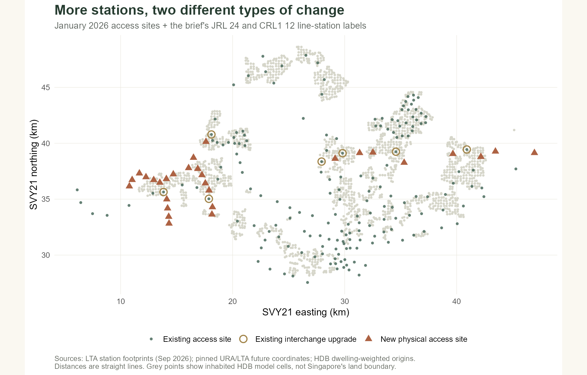
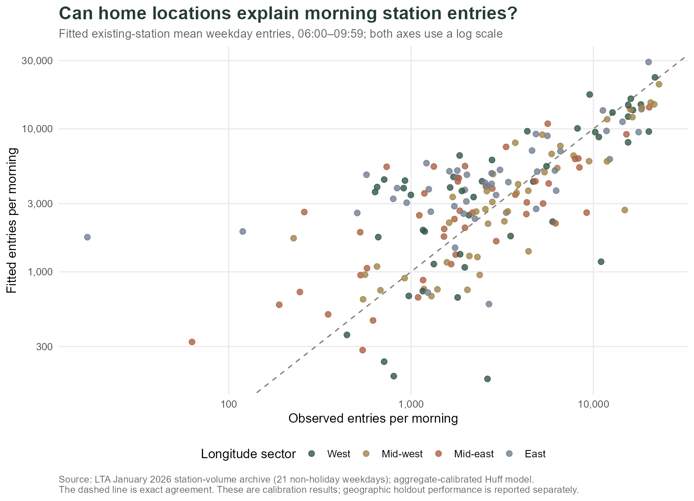
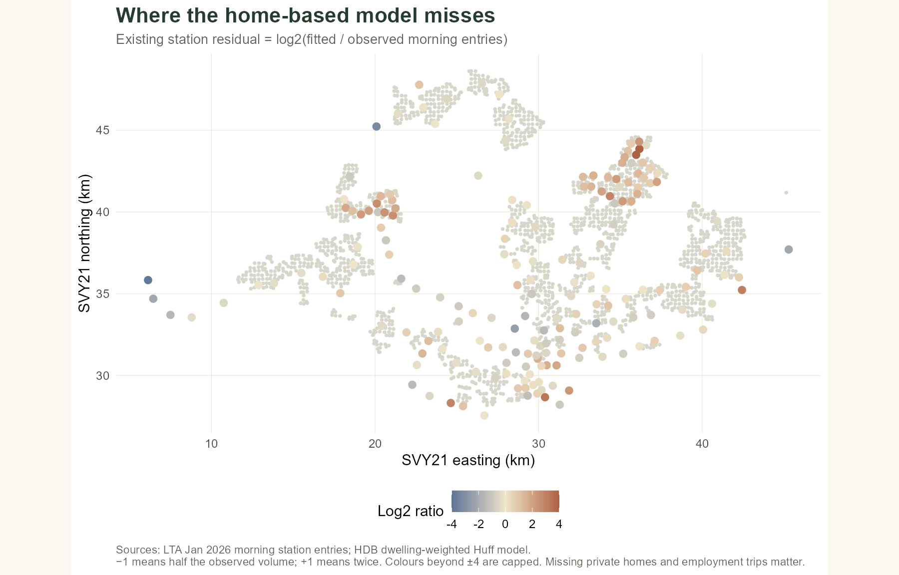
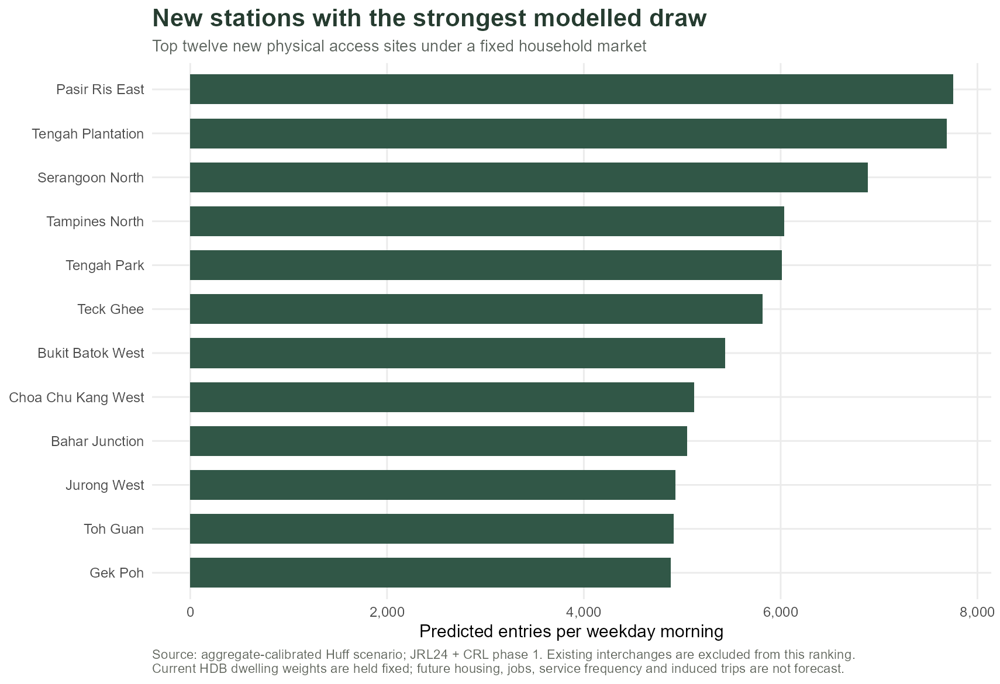
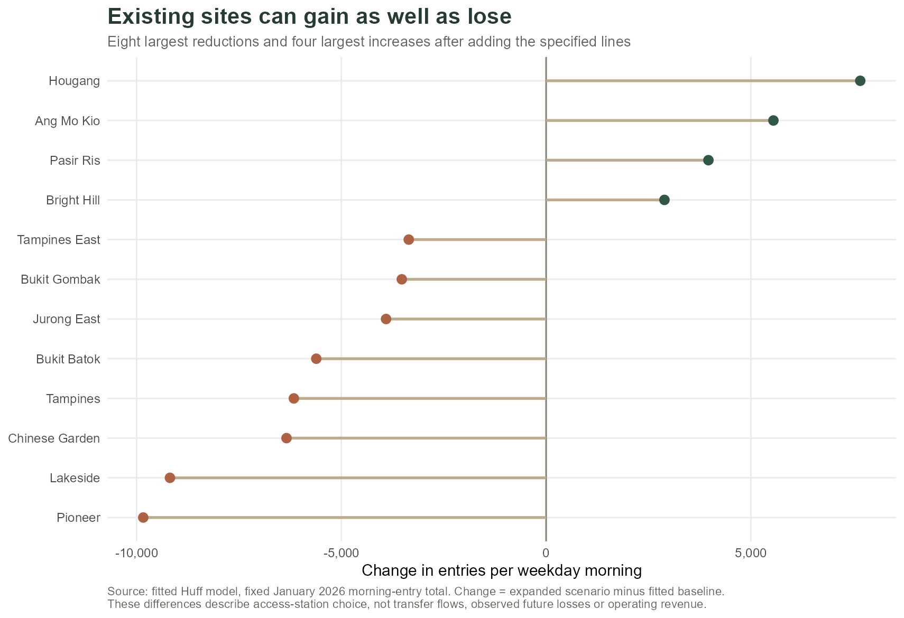
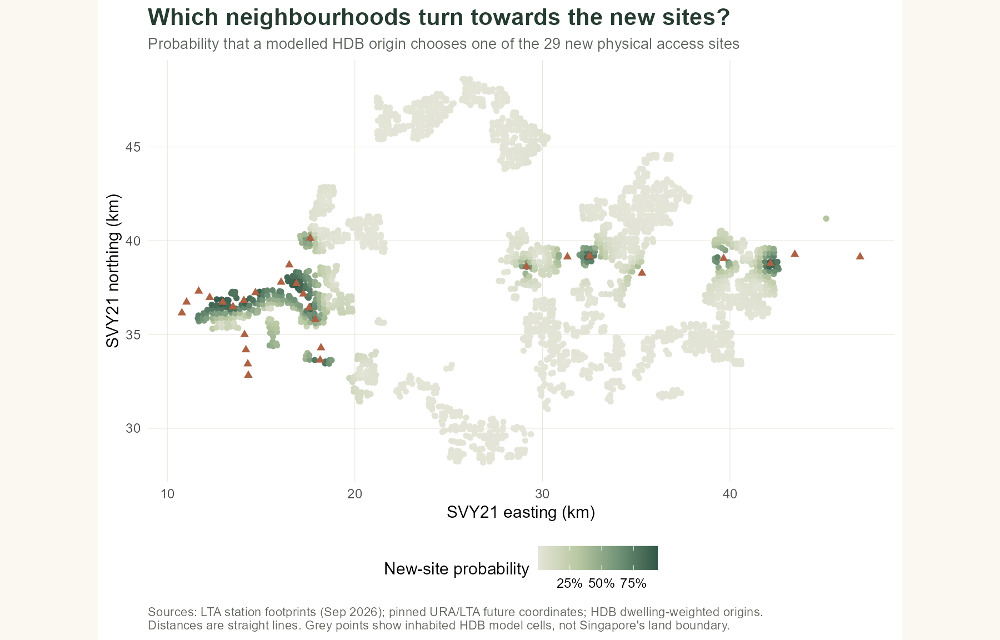
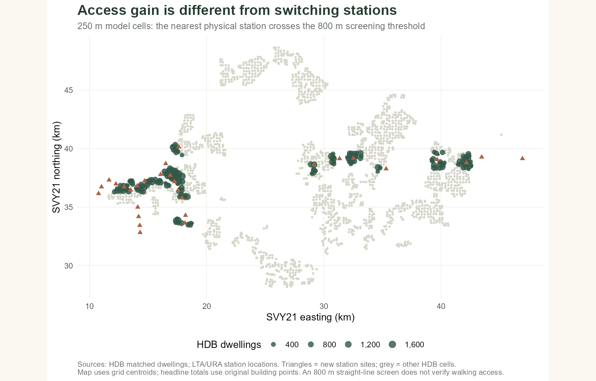

```{r}
#| include: false
# The normal render recomputes preparation, calibration and scenarios.
# The reuse switch is only for layout QA after the normal run has passed.
root03 <- "Take-home_Ex/Take-home_Ex03"
source(file.path(root03, "methods.R"), encoding = "UTF-8")
if (Sys.getenv("EX03_REUSE_VERIFIED") != "1") {
  source(file.path(root03, "analysis.R"), encoding = "UTF-8")
  source(file.path(root03, "visualise.R"), encoding = "UTF-8")
}
s <- readRDS(file.path(root03, "outputs/report-results.rds"))
stations <- s$stations
existing <- subset(stations, status == "existing")
new_sites <- subset(stations, status == "new")
num <- function(x, digits = 0) format(round(x, digits), big.mark = ",", trim = TRUE, scientific = FALSE)
pct <- function(x, digits = 1) paste0(num(100*x, digits), "%")
get_total <- function(label) s$scenario_totals$value[match(label, s$scenario_totals$measure)]
access800 <- subset(s$accessibility, threshold_m == 800)
best_new <- new_sites[order(-new_sites$expanded_daily), ][1, ]
largest_loss <- existing[order(existing$change_daily), ][1, ]
largest_gain <- existing[order(-existing$change_daily), ][1, ]
cv_cal <- subset(s$cv_metrics, grepl("^Calibrated", model))
cv_base <- subset(s$cv_metrics, grepl("^Inverse", model))
```

::: {.report-lead}
**Which stations gain access demand when new rail lines arrive—and where do households gain a closer station?** These are related questions, but they lead to different planning decisions. This study calibrates a household-weighted station-choice model, then adds the brief's Jurong Region Line (JRL) and Cross Island Line phase 1 (CRL1). The outcome is average **weekday 06:00–09:59 entries**, using January 2026 observed volumes.

[Executive summary](executive-summary.qmd) · [Source and reproducibility files](https://github.com/yufanyou2025/ISS626-VAA/tree/master/Take-home_Ex/Take-home_Ex03)
:::

## Study question and scope

Rail investment has a long lead time. A station can improve access before its surrounding catchment is fully developed, while an established station may lose some nearby users to a new alternative. A useful first step is to separate **new access** from **redistribution of existing access demand**.

The model asks how station entry shares would change if the specified JRL24 and CRL1's 12 stations were added to the January 2026 network, keeping the observed total and HDB housing stock fixed. I focus on mornings because residential locations are more plausible trip origins then than across an entire day. This is a deliberately narrower, more interpretable ridership outcome than total daily passengers.

The baseline contains `r nrow(existing)` observed physical station complexes. The expansion adds `r nrow(new_sites)` new access sites and upgrades seven existing interchanges, giving `r nrow(stations)` alternatives. Counting all 36 line-station labels as new independent stations would duplicate the seven interchanges' markets.

The brief uses a simplified 2030 framing. LTA's current project pages distinguish JRL stages in 2028–2029 and CRL1 in 2030. The later JRL infill JS2A, CRL phase 2 and Punggol Extension are outside this scenario. This analysis therefore compares defined networks; it is not an official opening-year forecast. [LTA JRL](https://www.lta.gov.sg/content/ltagov/en/upcoming_projects/rail_expansion/jurong_region_line.html), [LTA CRL](https://www.lta.gov.sg/content/ltagov/en/upcoming_projects/rail_expansion/cross_island_line.html).



::: {.interpretation}
The expansion has two mechanisms: it creates new access points and adds a rail line at existing ones. The first mainly changes which station is nearby; the second changes the attractiveness of a location that already exists. The JRL's western coverage and CRL1's northern/eastern corridor make a single island-wide catchment average insufficient.
:::

## Data, units and quality checks

| Input | Role and observation unit | Main decision |
|---|---|---|
| LTA January 2026 station volumes, pinned public archive | Hour × day type × station; tap-ins and tap-outs | Sum morning weekday tap-ins, divide by 21 non-holiday weekdays |
| HDB Existing Building footprints + Property Information | Building footprints and completed dwelling stock | Match block and verified street code; retain residential buildings with positive dwelling units |
| LTA TrainStation, September 2026 | Station footprints, including some later infrastructure | Restrict operating alternatives to the January observed identifiers |
| Assignment-linked URA/LTA coordinates | Existing and proposed line-station coordinates | Pin repository revision; merge seven interchanges by identity |
| Licensed HDB street-code bridge | Street code to normalized street name | Apply documented confidence checks; audit unmatched dwellings |

**Ridership records are entries, not people.** A commuter may contribute several entries in a month. Tap-outs are a separate measure and are not added to tap-ins. According to Annex A of the current [LTA API guide](https://datamall.lta.gov.sg/content/dam/datamall/datasets/LTA_DataMall_API_User_Guide.pdf), the values are totals across all days of a day type in the month, not typical-day means. Multiplying them by the number of weekdays would overstate demand.

The archive has 7,259 rows, 182 station identifiers, no duplicate station/day-type/hour keys, and no missing required cells. Stevens appears separately as `DT10` and `TE11`; their volumes are summed as `DT10/TE11`, giving 181 physical access sites while preserving every entry. Its 18,549,493 morning weekday entries become **`r num(s$settings$fixed_market)` entries per weekday morning**. January has 22 Monday–Friday dates, less the 1 January public holiday. Twenty-one combinations are absent within the network-wide 20 recorded hours; published totals are retained without inventing observations. Monthly tap-ins and tap-outs differ by 0.33%, so both are audited separately. [MOM public holidays](https://www.mom.gov.sg/newsroom/press-releases/2025/0616-public-holidays-for-2026).

The January file came from a pinned public archive because LTA's authenticated endpoint only retains recent months. Its hash and schema are checked; the archive cannot be independently certified against a current direct January download. The [provenance record](https://github.com/yufanyou2025/ISS626-VAA/blob/master/Take-home_Ex/Take-home_Ex03/notes/ridership-provenance.md) makes that limitation explicit.

```{r}
#| label: tbl-housing-audit
#| tbl-cap: "Sequential housing and spatial preparation audit. Source: executable preparation checks."
housing_audit <- readr::read_csv(file.path(root03, "outputs/hdb-origin-audit.csv"), show_col_types = FALSE)
knitr::kable(housing_audit)
```

### From buildings to spatial interaction tables

All geometry is transformed to **SVY21 / Singapore TM, EPSG:3414**, so distances are in metres. HDB polygons are checked and repaired where needed; representative points remain inside their footprints. A block number alone is not a unique address, so it is combined with the street mapping before dwelling counts are joined. Unmatched and uncertain records are reported rather than assigned guessed weights.

The matched sample contains **`r num(get_total('Source HDB building origins'))` buildings and `r num(get_total('Dwelling market potential'))` dwelling units**. These are dwellings, not residents or observed rail trips. A 250 m grid groups nearby building origins. Its representative point is the dwelling-weighted mean coordinate, and its market potential is the sum of dwelling units. This reduces computation while preserving total market weight. A 500 m alternative checks whether this simplification changes the main result. Coverage screening later returns to the original building points.

Two complete interaction frames use the same `origin_id` and `destination` keys. Every origin is paired with every physical station; the denominator is the full choice set, without a hard catchment cutoff. Required attraction and distance columns are stored alongside probabilities and market weights.

```{r}
#| label: tbl-interaction-example
#| tbl-cap: "Example rows of the existing-network interaction table; full tables are downloadable below."
preview <- readr::read_csv(file.path(root03, "outputs/interaction-existing-preview.csv"), show_col_types = FALSE)
knitr::kable(head(preview, 4), digits = 3)
```

- [Origin market potential](outputs/origin-market-potential.csv)
- [Destination observations and attractions](outputs/destination-attractions.csv)
- [Existing-network interactions, CSV.gz](outputs/interactions-existing.csv.gz)
- [Expanded-network interactions, CSV.gz](outputs/interactions-expanded.csv.gz)
- [Full spatial audit](outputs/spatial-preparation-audit.csv) and [station-coordinate checks](outputs/station-coordinate-audit.csv)

## Probabilistic spatial interaction model

### A transferable attraction measure

For origin $i$ and physical station $j$, the Huff probability is

$$
P_{ij}=\frac{L_j^{\beta}(d_{ij}+\delta)^{-\alpha}}
{\sum_{k\in J}L_k^{\beta}(d_{ik}+\delta)^{-\alpha}},
\qquad
\hat Y_j=T\sum_i\frac{H_i}{\sum_i H_i}P_{ij}.
$$

$H_i$ is HDB dwelling market potential; $L_j$ is the number of distinct rail lines serving the physical station; $d_{ij}$ is straight-line access distance; and $T$ is the observed morning-entry market. The main offset $\delta=200$ m avoids an extreme advantage when an origin lies very close to a representative station point. Offsets of 100 and 400 m are checked.

More rail lines are a simple proxy for onward connectivity. This measure exists for proposed stations and avoids using observed ridership as its own explanatory variable. It does not measure frequency, capacity, destination accessibility or station entrances. A station with twice as many lines receives a utility multiplier of $2^\beta$, before distance is considered.

The formulation follows the Huff station-choice logic discussed by [Zhu et al. (2021)](https://doi.org/10.1155/2021/6374724). Their multimodal Xi'an application is richer than this straight-line Singapore model; its coefficients are not imported here.

### Calibration and validation

Household-to-station choices are unobserved. I therefore calibrate **aggregate station shares**, rather than treating rail-station OD trips as observed home-to-station choices. `optim()` minimizes mean squared log-share error, so small stations receive attention alongside the busiest ones. The decay is constrained to 0.5–5 and the line coefficient to 0–2. Six deterministic starting points check optimization stability. These are calibration parameters, not causal estimates of commuter preferences.

The comparison model uses equal attractions and inverse-square distance. Geographic validation holds out station outcomes in four longitude sectors. Every station remains a competing destination; only the held-out volumes are hidden. The training stations determine both parameters and the count scale. This checks transfer across broad regions, although it is not a test on genuinely future stations.

```{r}
#| label: tbl-coefficients
#| tbl-cap: "Calibrated parameters and allowed bounds; boundary flags indicate a constrained optimum."
knitr::kable(s$fit$bounds, digits = 3)
```

```{r}
#| echo: false
#| results: asis
cat("<details class='workflow-code'><summary>R implementation: probability calculation</summary>\n\n```r\n",
    paste(deparse(huff_prob), collapse = "\n"), "\n```\n</details>", sep = "")
```



::: {.interpretation}
Points far from the diagonal show where dwelling locations and a line-count attraction proxy are insufficient. In the geographic holdouts, weighted absolute percentage error falls from **`r pct(cv_base$WAPE)`** for the distance-only baseline to **`r pct(cv_cal$WAPE)`** for the calibrated model. This is a useful improvement, but the remaining error is large. The model supports broad catchment comparisons more convincingly than precise station-volume forecasts.
:::

```{r}
#| label: tbl-model-performance
#| tbl-cap: "Existing-network fit and geographic holdout errors. MAE/RMSE are entries per weekday morning; WAPE is a proportion."
performance <- dplyr::bind_rows(
  dplyr::mutate(s$metrics, assessment = "Calibration"),
  dplyr::mutate(s$cv_metrics, assessment = "Geographic holdout"))
knitr::kable(dplyr::select(performance, assessment, model, stations, MAE, RMSE, WAPE, RMSLE, Spearman), digits = 3)
```



::: {.interpretation}
Residual geography is a warning against reading the scenario as a precise forecast. HDB housing weights omit private homes, hotels and employment-generated entries; a central or industrial station can therefore be underpredicted even if its location is correct. Positive residuals show the reverse mismatch. The separate [all-day diagnostic](outputs/all-day-metrics.csv) uses the same structure, but has an even broader mixture of trip origins.
:::

## Expansion: predicted entries and changing markets

The fitted coefficients are held fixed. New physical stations enter each origin's denominator; seven existing complexes gain a line. Dwelling weights and the total morning market stay unchanged. Changes are measured against the **fitted baseline**, so a baseline fitting error is not mistaken for a future policy effect.

The new sites receive **`r num(get_total('New-site weekday AM entries per day'))` modelled entries per weekday morning**, or **`r pct(get_total('New-site share of fixed market'))`** of the fixed market. This is redistributed demand within this model; it does not imply an increase of that size in system-wide trips.



::: {.interpretation}
**`r best_new$station_name`** has the largest prediction among new physical access sites: about **`r num(best_new$expanded_daily)` entries per weekday morning**. The ranking reflects the current HDB market and the model's distance/connectivity rules. Stations serving future development or non-residential destinations may have demand that this snapshot misses. Treat the ranking as a starting point for catchment investigation.
:::



::: {.interpretation}
**`r largest_loss$station_name`** has the largest reduction: approximately **`r num(abs(largest_loss$change_daily))` entries per morning**, or **`r pct(abs(largest_loss$change_pct)/100)`** of its fitted baseline. In contrast, **`r largest_gain$station_name`** gains about **`r num(largest_gain$change_daily)`** as its added line improves connectivity. These are changes in where users enter. Transfer flows and network value can follow a different pattern from local access entries.
:::



::: {.interpretation}
Catchments overlap. A darker cell means a larger combined probability of choosing one of the new sites, rather than exclusive ownership by one station. **`r pct(get_total('Share of dwelling weight changing leading station'))`** of the model's dwelling weight changes its most likely station. The probability map retains softer shifts that a winner-only map would hide.
:::

### Inspect any station

<iframe src="figures/station-explorer.html" title="Interactive station scenario explorer" width="100%" height="520" style="border:1px solid #d9d3c3;border-radius:4px;"></iframe>

::: {.interpretation}
Select a station to compare observed, fitted and scenario morning entries. Marker size represents scenario demand; colour distinguishes new and existing physical sites. The observed column is blank for proposed sites because they were not open in the baseline. Basemap tiles require an internet connection; the analytical figures remain available as static images.
:::

The [complete station table](outputs/station-results.csv) includes every existing and proposed site's prediction. The [future-station scope table](outputs/future-station-scope.csv) records the seven merges explicitly.

## Added analysis: closer access or a different station?

A high modelled entry count does not necessarily indicate many newly served homes. To examine that difference, I calculate each original HDB building point's distance to its nearest station before and after expansion, then weight the threshold crossing by dwelling units. The 800 m threshold is a screening assumption; 600 and 1,000 m alternatives show its sensitivity.



::: {.interpretation}
At the original building points, **`r num(access800$dwellings_newly_served)` matched dwellings** move inside the 800 m straight-line screen. This identifies an access benefit that is different from shifting between two already nearby stations. It provides a reason to prioritise pedestrian-link and feeder-service checks in newly covered areas, even where predicted entry totals are modest. Actual routes may be longer because of expressways, waterways or disconnected paths.
:::

```{r}
#| label: tbl-accessibility
#| tbl-cap: "Dwelling-weighted nearest-station coverage, measured at original HDB building points."
knitr::kable(dplyr::select(s$accessibility, threshold_m, dwellings_before, dwellings_after,
                         dwellings_newly_served, dwellings_still_beyond), digits = 0,
             col.names = c("Screen (m)", "Before", "After", "Newly inside", "Still beyond"))
```

The contribution is to distinguish **coverage expansion** from **competition for an existing market**. It supports a practical two-stage decision: identify homes whose access improves, then inspect the walking routes and service provision around those locations. It is not a network accessibility assessment, and the matched HDB sample is not an island-wide equity measure.

## Sensitivity, limitations and planning implications

```{r}
#| label: tbl-sensitivity
#| tbl-cap: "Alternative distance offsets and origin scales; ranges are specification sensitivity, not statistical confidence intervals."
knitr::kable(dplyr::select(s$sensitivity, specification, decay, beta_lines, MAE, new_station_share), digits = 3)
```

The new-site market share ranges from **`r pct(min(s$sensitivity$new_station_share))` to `r pct(max(s$sensitivity$new_station_share))`** across these specifications. Stability in an aggregate share does not guarantee stability in every station's rank; [station-level sensitivity results](outputs/sensitivity-station-results.csv) are supplied for that comparison.

Five limits matter for decisions:

1. **Housing stock is a market proxy.** Dwelling sizes, occupancy and propensity to use rail differ. All eligible HDB dwelling records match, but private homes and non-residential trip origins are missing.
2. **Access is straight-line.** Representative station points are not entrances. Walking barriers, cycling and feeder-bus services can change station choices.
3. **Aggregate fit is underidentified behaviourally.** Several combinations of access and attraction may explain station totals. Bounds, holdout errors and residual geography are therefore part of the result.
4. **The market is fixed.** There is no mode shift, future housing or employment, fare response, service frequency change or capacity constraint. The model cannot estimate induced demand or opening-year revenue.
5. **The baseline is historical.** January volumes and later spatial snapshots are reconciled by station identity, but do not capture every subsequent development. The third-party ridership archive has an explicit verification limit.

For planning, use the results to shortlist catchments for further study. High predicted new-site demand suggests checking station approaches, crossings and feeder connections. Large shifts at existing sites suggest reviewing feeder routes across the wider corridor rather than judging one station in isolation. Newly covered dwellings identify a separate access benefit. Before making capacity or operating decisions, add pedestrian-network access, private housing, employment and proposed service levels, then validate against more recent months.

## What I learnt and how the class methods helped

The main lesson for me was that defining the market matters as much as choosing the model. A model can produce a clear map while still answering a narrower question than the reader expects.

**Spatial preparation comes first.** The class work with `sf`, coordinate systems and joins helped me prepare comparable origins and destinations in EPSG:3414. Stevens was a useful example: its two observed station codes represent one physical access site. Leaving them separate would change the choice probabilities, even if the distance calculations were correct. I also learnt to keep dwelling units, station entries and individual passengers separate throughout the analysis.

**The Huff framework explains competition between stations.** [Exercise 8](../../In-class_Ex/In-class_Ex08/In-class_Ex08.qmd) provided the origin–destination tables, attraction variables, distance decay and population-weighted market-share framework. Here, I adapted that structure to HDB dwelling weights and extended the fixed-parameter classroom example by calibrating shared parameters against observed station totals. The useful insight is that catchments overlap: the nearest station need not receive all of an origin's demand.

**Accessibility and demand answer different questions.** The accessibility comparisons in [Exercise 7](../../In-class_Ex/In-class_Ex07/In-class_Ex07.qmd) helped me distinguish a closer facility from a more competitive destination. This led to the separate building-level coverage check. A new station can attract users who already have nearby rail access, while another can bring previously distant homes closer to the network. Those benefits should be assessed separately.

**Validation changes how I interpret a prediction.** The diagnostic work in [Exercise 9](../../In-class_Ex/In-class_Ex09/In-class_Ex09.qmd) reinforced the value of examining residual geography rather than relying on one fit statistic. The geographic holdout WAPE of `r pct(cv_cal$WAPE)` makes me cautious about individual station forecasts, despite improvement over the baseline. From a finance and accounting perspective, I would use these results to shortlist locations for further investigation; entry volumes alone cannot establish an investment return without costs, service plans and a stronger demand forecast.

## Reproduce the workflow

The R scripts separate [spatial preparation](prepare-spatial.R), [ridership preparation](prepare-ridership.R), [model functions](methods.R), [analysis](analysis.R) and [visualisation](visualise.R). They check station keys, probability sums, total demand, housing-market mass and scenario merges. Source URLs, access dates, hashes, exclusions and optimizer diagnostics are written to `outputs/`.

```{r}
#| eval: false
# From the ISS626-VAA project root, after installing documented packages:
source("Take-home_Ex/Take-home_Ex03/analysis.R", encoding = "UTF-8")
source("Take-home_Ex/Take-home_Ex03/visualise.R", encoding = "UTF-8")
# Or render the report directly: its normal first chunk runs both scripts.
```

The repository README documents downloads and package installation. `render.ps1` renders the report, runs numerical verification, renders the revealjs deck and refreshes shared navigation. Browser checks test images, the interactive map, slide clipping and mobile width. The layout-only reuse switch is not needed for normal reproduction. [R session information](outputs/session-info.txt), [model audit](outputs/model-audit.csv), [optimizer starts](outputs/optimizer-diagnostics.csv).

## References and attribution

- Land Transport Authority. *Passenger Volume by Train Stations*, January 2026. Accessed 1 November 2026 through the [pinned archive](https://github.com/tiredbeaver/busy-island/blob/c13cb5943fea4a0118fc6b5b65a9eb923961e31f/data/transport_node_train_202601.csv). [Singapore Open Data Licence](https://datamall.lta.gov.sg/content/datamall/en/SingaporeOpenDataLicence.html). Contains information from LTA; no endorsement implied.
- Land Transport Authority. *TrainStation, September 2026*, supplied public ZIP. [DataMall static datasets](https://datamall.lta.gov.sg/content/datamall/en/static-data.html). Singapore Open Data Licence.
- Housing & Development Board. [HDB Existing Building](https://data.gov.sg/datasets/d_16b157c52ed637edd6ba1232e026258d/view) and [HDB Property Information](https://data.gov.sg/datasets/d_17f5382f26140b1fdae0ba2ef6239d2f/view), accessed 1 November 2026. Singapore Open Data Licence.
- Wu, T. *Singapore Train Station Coordinates*, [revision 9f5972c](https://github.com/elliotwutingfeng/singapore_train_station_coordinates/tree/9f5972c71db8a529801eee9c527946a45a78e409). URA/LTA coordinate data under Singapore Open Data Licence.
- Heide, M. *Singapore Urban Heat*, [HDB street-code bridge](https://github.com/mooofna/singapore-urban-heat/tree/0e7da4ea27f6bcd74b13514dd0e371a0da6c91fb), CC BY 4.0; underlying HDB information under Singapore Open Data Licence. Used for address linkage, not analysis or findings.
- Zhu, Z., He, Y., Guo, X., Zhang, Y., & Chen, J. (2021). [Improved Huff Model for Estimating Urban Rail Transit Station Catchment Areas considering Station Choices](https://doi.org/10.1155/2021/6374724). *Journal of Advanced Transportation*, 6374724.
- R Core Team; `sf`, `dplyr`, `tidyr`, `readr`, `ggplot2`, `leaflet`, `htmlwidgets`, `digest`, `jsonlite`, `knitr` and Quarto. Exact installed versions appear in the session record. Interactive basemap: © OpenStreetMap contributors, as attributed on the map.
